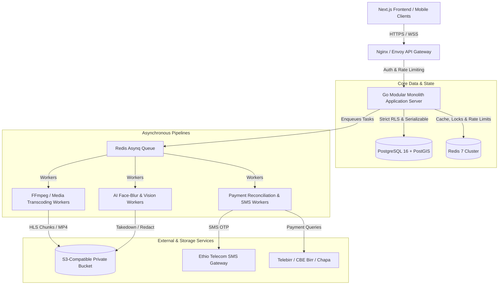
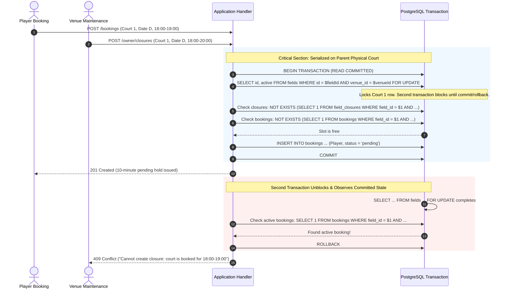
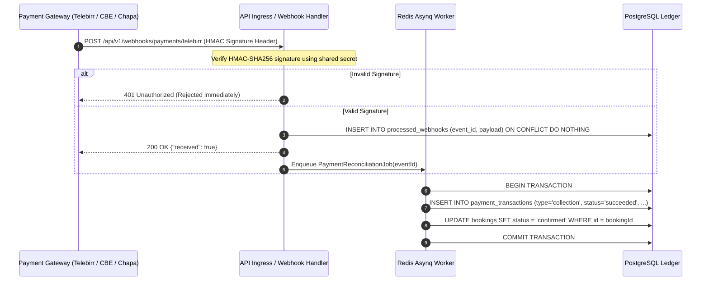
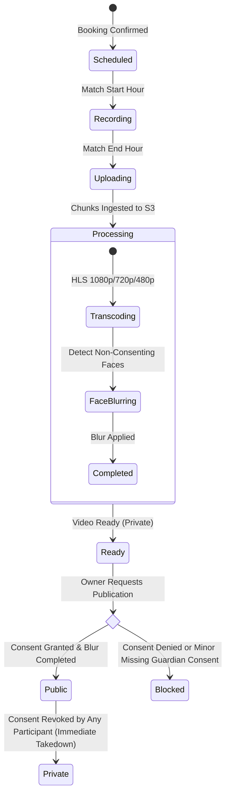
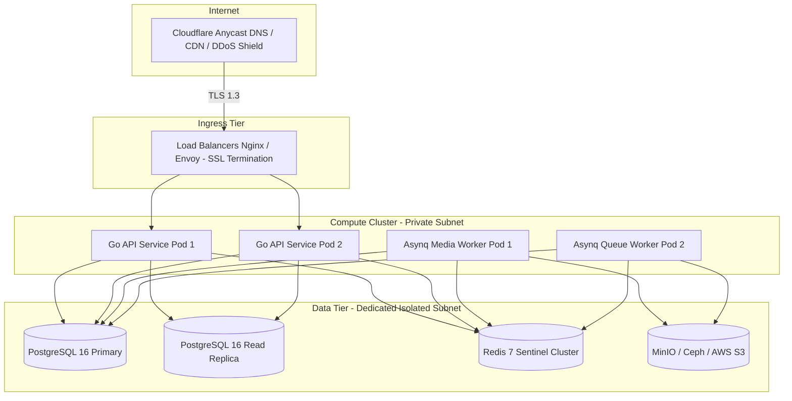

# Smartify Stadiums Backend Architecture Specification (Milestone M7)

> **Document Status**: Authoritative Architecture Specification & Engineering Review Baseline  
> **Milestone**: M7 (Backend, API, Schema, Concurrency & Security Architecture Design)  
> **Repository Baseline**: Branch `codex/backend-architecture` (derived from `6ea859b`)  
> **Reference Documents**: [FRONTEND_MASTER_PLAN.md](file:///C:/Users/USER/Documents/GitHub/smartify-stadiums-frontend/FRONTEND_MASTER_PLAN.md), [FRONTEND_ACCEPTANCE.md](file:///C:/Users/USER/Documents/GitHub/smartify-stadiums-frontend/FRONTEND_ACCEPTANCE.md), [SYSTEM_CONCEPT.md](file:///C:/Users/USER/Documents/GitHub/smartify-stadiums-frontend/SYSTEM_CONCEPT.md)  
> **Target Technology Stack**: Go 1.22+, PostgreSQL 16+ (PostGIS), Redis 7+ (asynq), S3-compatible Object Storage  
> **Commercial Policy Status**: All commission fees, subscription prices, and cancellation schedules remain strictly **provisional and configurable** pending formal founder approval.

---

## Table of Contents
1. [Executive Architecture Overview](#1-executive-architecture-overview)
2. [Domain Model & Unified Vocabulary](#2-domain-model--unified-vocabulary)
3. [API Contracts, Authentication & Tenant Authorization](#3-api-contracts-authentication--tenant-authorization)
4. [Database Schema, Concurrency & Idempotency](#4-database-schema-concurrency--idempotency)
5. [Payment Ledger, Webhooks, Reconciliation & Refunds](#5-payment-ledger-webhooks-reconciliation--refunds)
6. [Autonomous Media, Privacy Consent, Retention & Processing Queues](#6-autonomous-media-privacy-consent-retention--processing-queues)
7. [Deployment, Observability, Disaster Recovery & Security Architecture](#7-deployment-observability-disaster-recovery--security-architecture)
8. [Integration Acceptance Test Suite & Verification Matrix](#8-integration-acceptance-test-suite--verification-matrix)

---

## 1. Executive Architecture Overview

### 1.1 Architectural Objectives
The backend architecture for Smartify Stadiums (ET Smart Fields) transitions the verified, founder-approved frontend implementation (Milestone M6, commit `6ea859b`) into an enterprise-grade, multi-tenant sports facility operating system. 



### 1.2 Non-Negotiable Invariants
1. **Zero Double-Bookings**: Physical court capacity is strictly immutable. If Court 1 is reserved for 18:00–19:00 for Football, no concurrent or overlapping reservation (Basketball, Volleyball, Futsal, or Maintenance Closure) can ever commit, guaranteed by database exclusion constraints.
2. **Multi-Sport Physical Court Sharing**: A physical court may be marked as compatible with multiple sports (e.g. Futsal, Basketball, Volleyball). Sports do not possess independent inventory; they share the single physical court asset.
3. **Multi-Tenant Boundary Isolation**: Venue owners are strictly isolated to their registered venues. Database-level Row-Level Security (RLS) ensures that cross-tenant queries return empty sets or authorization denials even in the event of application logic regressions.
4. **Immutable Append-Only Financial Ledger**: Payment records and financial settlements are never mutated or deleted. Every financial event (collection, refund, adjustment, payout) is an explicit append-only ledger transaction. Derived payment states are calculated dynamically from ledger balances.
5. **Fail-Closed Security & Privacy**: Media recordings default to private. Minor/academy bookings enforce mandatory guardian consent before public rendering. Face-blur pipelines must complete successfully prior to public visibility. Instant revocation immediately unpublishes media.
6. **Provisional Commercial Boundaries**: Commission rates (e.g. 5%), monthly SaaS subscription tiers, and penalty percentages are stored as dynamic configuration parameters with `is_approved = false`. No commercial policy is hardcoded.

---

## 2. Domain Model & Unified Vocabulary

To eliminate discrepancies between frontend TypeScript contracts ([contracts.ts](file:///C:/Users/USER/Documents/GitHub/smartify-stadiums-frontend/frontend/src/services/contracts.ts)) and backend data structures, the domain vocabulary is strictly standardized:

| Domain Entity | Canonical Name | Definition & Invariants |
| :--- | :--- | :--- |
| **User Role** | `Role` | Strictly `'player' \| 'owner' \| 'admin'`. Installers or staff are modeled as venue-scoped capability flags on owner accounts. |
| **Sport** | `Sport` | Strictly `'football' \| 'basketball' \| 'volleyball' \| 'badminton' \| 'tennis' \| 'futsal'`. Running and padel are excluded from the active schema. |
| **Currency** | `Currency` | Strictly `'ETB'`. All monetary values across all database tables, APIs, and logs are non-negative integer minor units (Ethiopian Birr cents: `1 ETB = 100 minor units`). Float/decimal representations are strictly prohibited in the persistence and financial layers. |
| **Venue** | `Venue` | Physical facility entity. Lifecycle status: `'draft' \| 'pending' \| 'changes_requested' \| 'active' \| 'suspended'`. |
| **Court / Field** | `Field` | Physical playable surface owned by a venue. Holds array of supported `Sport[]`, hourly rate in `hourlyRateMinor`, lighting status, camera attachment, and operating hours. |
| **Booking** | `Booking` | Time-bound reservation of a physical court. Status: `'pending' \| 'confirmed' \| 'cancelled' \| 'completed' \| 'no_show'`. Source: `'online' \| 'walk_in'`. |
| **Ledger Entry** | `PaymentTransaction`| Append-only transaction record. Types: `'collection' \| 'refund' \| 'adjustment' \| 'payout'`. Status: `'recorded' \| 'succeeded' \| 'failed'`. |
| **Derived Payment** | `PaymentStatus` | Computed state: `'unpaid' \| 'processing' \| 'partially_paid' \| 'paid' \| 'failed' \| 'refunded' \| 'partially_refunded'`. |
| **Camera Device** | `Camera` | Edge recording hardware. Certification: `'pending' \| 'passed' \| 'failed' \| 'revoked'`. Connectivity: `'online' \| 'offline' \| 'unknown'`. |
| **Match Recording** | `MatchRecording` | Video asset linked to a booking. Status: `'scheduled' \| 'recording' \| 'uploading' \| 'processing' \| 'ready' \| 'failed'`. |
| **Privacy Consent** | `PrivacyConsent` | Participant consent state: `status: 'pending' \| 'granted' \| 'denied' \| 'revoked'`; optional `guardianConsentStatus: 'pending' \| 'granted' \| 'denied'`. |

---

## 3. API Contracts, Authentication & Tenant Authorization

### 3.1 Standard API Envelope, Bare DTOs & Error Format
The frontend HTTP transport (`frontend/src/services/http.ts`) invokes `return await response.json() as T` directly without unwrapping an outer wrapper. To maintain strict compatibility with the founder-approved frontend services and prevent runtime client deserialization crashes:

1. **Bare Response DTOs (Default / Native Contract)**:
   - Successful REST responses return the raw entity or collection DTO directly matching the TypeScript interfaces in [`contracts.ts`](file:///C:/Users/USER/Documents/GitHub/smartify-stadiums-frontend/frontend/src/services/contracts.ts):
     - Single entities (`Account`, `Venue`, `Booking`, `Field`, `Microsite`): returned as top-level JSON objects `{ ... }`.
     - Entity collections (`Venue[]`, `Field[]`, `Booking[]`, `Invoice[]`): returned as top-level JSON arrays `[ ... ]`.
     - Operations yielding no content (`logout`, `cancel`, `request-otp`): returned as HTTP 204 No Content (or HTTP 200 `{}`).
2. **Optional Envelope Adapter (`X-API-Envelope: true`)**:
   - For external or third-party integrators requesting envelope wrapping, setting header `X-API-Envelope: true` causes the API gateway to wrap responses into `{ "success": true, "data": T, "meta": { "requestId": "req_...", "timestamp": "..." } }`. The native Next.js frontend omits this header and consumes bare DTOs.
3. **Error Format (RFC 7807 Problem Details)**:
   - On non-2xx HTTP responses, the backend emits RFC 7807 Problem Details:
     ```json
     {
       "type": "https://api.smartifystadiums.et/errors/conflict",
       "title": "Conflict",
       "status": 409,
       "detail": "This court reservation conflicts with an existing booking or maintenance closure.",
       "instance": "/bookings",
       "code": "SLOT_ALREADY_RESERVED",
       "requestId": "req_01JAX89Y7BZ91A20"
     }
     ```
   - Frontend `http.ts` catches `!response.ok` and transforms the HTTP status code via `statusCode(response.status)` into typed client `ServiceError` instances (`validation` for 400, `unauthorized` for 401, `forbidden` for 403, `not_found` for 404, `conflict` for 409, `rate_limited` for 429, `server` for 500+).
4. **CSRF Protection & Token Contract (`/auth/csrf`)**:
   - Before any state-modifying HTTP request (`POST`, `PUT`, `PATCH`, `DELETE`), `frontend/src/services/http.ts` automatically issues:
     `GET /api/v1/auth/csrf` with `{ credentials: 'include', cache: 'no-store' }`.
   - The backend MUST provide this endpoint and return a bare JSON object:
     ```json
     {
       "token": "csrf_01JAX89Y7BZ91A20_a9f8b2c4e1d3"
     }
     ```
   - The token is cryptographically generated using HMAC-SHA256 bound to the user's session identifier or double-submit CSRF cookie.
   - The frontend reads `value.token` and attaches header `X-CSRF-Token: <token>`.
   - The backend CSRF middleware verifies `X-CSRF-Token` against the active session before dispatching mutation handlers. Missing or invalid tokens return HTTP 403 Forbidden with error code `CSRF_TOKEN_INVALID`. Safe idempotent methods (`GET`, `HEAD`, `OPTIONS`) bypass CSRF verification.

### 3.2 Authentication & Phone OTP Lifecycle
The authentication flow strictly matches the request bodies, methods, and types in [`auth.service.ts`](file:///C:/Users/USER/Documents/GitHub/smartify-stadiums-frontend/frontend/src/services/auth.service.ts):

1. **Request OTP (`POST /api/v1/auth/request-otp`)**:
   - Request Body: `{"phone": "+251911223344", "purpose": "login"}` (or `"register"`).
   - Phone Normalization: Phone number must validate against Ethiopian telecom prefix patterns (`+2519...` or `+2517...`).
   - Throttling: Redis-backed sliding window rate limiter permits maximum 3 OTP requests per 10 minutes per IP and phone number. 60-second cooldown enforced between consecutive requests.
   - Generation: Cryptographically secure pseudo-random 6-digit integer string (`crypto/rand`).
   - Storage: Stored in Redis with key `otp:{phone}` containing Argon2id hash of code, attempt count (max 3), purpose, and TTL of 300 seconds (5 minutes). Plaintext OTP is NEVER stored.
   - Dispatch: Dispatched via Ethio Telecom SMS Gateway over secure TLS webhook. Returns HTTP 200 `{ "status": "sent" }` or HTTP 204.
2. **Login / Verify OTP (`POST /api/v1/auth/login`)**:
   - Request Body: `{"phone": "+251911223344", "code": "482910"}` (field name `code`, matching frontend `auth.service.ts`).
   - Verification: Compares submitted OTP `code` against hashed value using constant-time comparison (`subtle.ConstantTimeCompare`).
   - Protection: Any failed verification increments attempt counter. Reaching 3 failed attempts immediately deletes the Redis key and invalidates the OTP.
   - Successful Session:
     - Issues session cookie (see Cookie Architecture below).
     - Generates cryptographically signed JWT containing: `sub` (user UUID), `role` (`player | owner | admin`), `venueId` (if owner), `jti` (session UUID for revocation), `exp` (14 days), `iat`.
     - Redis stores active session record `session:{userId}:{jti}` with metadata (`ip`, `userAgent`, `createdAt`, `lastActiveAt`).
     - Response Body: Returns bare `Account` DTO directly:
       ```json
       {
         "id": "usr_01JAX89Y7BZ91A20",
         "phone": "+251911223344",
         "full_name": "Abebe Kebede",
         "role": "player",
         "email": "abebe@example.com",
         "is_verified": true,
         "is_minor": false,
         "created_at": "2026-10-20T00:30:00.000Z",
         "status": "active"
       }
       ```
3. **Register (`POST /api/v1/auth/register`)**:
   - Request Body: `{"phone": "+251911223344", "code": "482910", "full_name": "Abebe Kebede", "role": "player"}` (role strictly `'player' | 'owner'`; `'admin'` cannot be self-registered).
   - Validates OTP code, creates user record in `users` table, provisions session, and returns bare `Account` DTO.
4. **Current User (`GET /api/v1/users/me`)**:
   - Headers: Cookie session (`credentials: 'include'`). Accepts optional `AbortSignal`.
   - Returns authenticated user's bare `Account` DTO.
5. **Logout (`POST /api/v1/auth/logout`)**:
   - Invalidates active session `jti` in Redis, clears the session cookie (`Max-Age=0`), and returns HTTP 204 No Content.
6. **Cookie Architecture Across Subdomains & Microsites**:
   - Per RFC 6265bis, cookies with the `__Host-` prefix MUST NOT include a `Domain` attribute and are strictly confined to the exact originating host.
   - To support both unified same-origin deployments and multi-subdomain SaaS microsites (`unity-complex.smartifystadiums.et`), two deployment modes are specified:
     - **Mode A (BFF / Same-Origin Reverse Proxy - Default)**: Next.js frontend proxies `/api/*` on `smartifystadiums.et`. Session cookie uses `__Host-etsf-session; Path=/; Secure; HttpOnly; SameSite=Lax`. All path-based microsites (`/s/unity-complex`) share this cookie seamlessly.
     - **Mode B (Multi-Subdomain SaaS Deployment)**: Direct API calls between custom venue subdomains (`*.smartifystadiums.et`) and `api.smartifystadiums.et`. RFC 6265bis mandates using the `__Secure-` prefix instead of `__Host-` so the cookie can span subdomains:
       `Set-Cookie: __Secure-etsf-session=<jwt>; Domain=.smartifystadiums.et; Path=/; Secure; HttpOnly; SameSite=Lax`.
     - The active mode is determined at deploy time via `SESSION_COOKIE_MODE=host|domain`.
7. **Session Revocation & Instant Suspension Enforcement**:
   - **Session Revocation**: On logout or explicit session invalidation, `DEL session:{userId}:{jti}` is executed and `jti` is added to a Redis revocation set `revoked:{jti}` with TTL equal to remaining JWT lifetime.
   - **Administrative Suspension Enforcement**:
     - When a platform administrator suspends an account (`PATCH /api/v1/admin/users/:id/status` with `status: "suspended"`), the update commits to `users.status = 'suspended'`.
     - Application immediately purges all active session keys for the user (`session:{userId}:*`).
     - A Redis tombstone `suspension:{userId}` is written with a 24-hour TTL, and a broadcast event is published via Redis Pub/Sub (`events:user_suspended:{userId}`) to evict all local in-memory JWT caches across all Go worker instances within < 50ms.
     - Auth middleware checks `user.status` on every authenticated request. Suspended users are immediately denied with HTTP 403 Forbidden:
       ```json
       {
         "type": "https://api.smartifystadiums.et/errors/forbidden",
         "title": "Account Suspended",
         "status": 403,
         "detail": "Your account has been suspended by the platform administrator.",
         "code": "ACCOUNT_SUSPENDED"
       }
       ```

### 3.3 Multi-Tenant Authorization & Subdomain Routing
1. **Tenant Context Extraction**:
   - Requests entering the API gateway carry either:
     - Custom subdomain: `https://unity-complex.smartifystadiums.et`
     - Path-based microsite identifier: `https://smartifystadiums.et/s/unity-complex`
     - Tenant management header: `X-Venue-Id: venue-2`
   - Gateway verifies hostname or path against `venues` table. If status is `suspended` or `draft`, access is denied or routed to the unpublish/preview renderer based on caller identity.
2. **Row-Level Security Enforcement**:
   - When handling requests on behalf of a authenticated owner, the database connection pool executes:
     ```sql
     SET LOCAL app.current_user_id = 'usr_owner_1';
     SET LOCAL app.current_user_role = 'owner';
     SET LOCAL app.current_tenant_id = 'venue_1';
     ```
   - All queries on tables with a `venue_id` column are filtered by RLS:
     ```sql
     CREATE POLICY venue_isolation_policy ON fields
     FOR ALL TO application_role
     USING (
       app.current_user_role() = 'admin' OR 
       venue_id = app.current_tenant_id()
     );
     ```

### 3.4 Exhaustive API Contract Endpoints

| Domain | Method | Endpoint | Access Role | Description |
| :--- | :--- | :--- | :--- | :--- |
| **Auth** | `POST` | `/api/v1/auth/request-otp` | Public | Request SMS OTP with rate-limiting. |
| | `POST` | `/api/v1/auth/login` | Public | Verify OTP and issue session cookie. |
| | `POST` | `/api/v1/auth/register` | Public | Register new player or venue owner account. |
| | `GET` | `/api/v1/users/me` | Authenticated | Retrieve authenticated user profile and roles. |
| | `POST` | `/api/v1/auth/logout` | Authenticated | Revoke session in Redis and clear cookie. |
| **Venues** | `GET` | `/api/v1/stadiums` | Public | Search and list active stadiums with filters. |
| | `GET` | `/api/v1/stadiums/:slug` | Public | Get stadium public microsite profile by slug. |
| | `GET` | `/api/v1/stadiums/:id/fields` | Public | List operational courts and pricing for venue. |
| | `GET` | `/api/v1/owner/stadiums` | Owner / Admin | List venues owned by authenticated owner. |
| | `POST` | `/api/v1/owner/stadiums` | Owner | Submit new stadium profile for admin review. |
| | `POST` | `/api/v1/owner/stadiums/:id/submit`| Owner | Request admin verification for draft venue. |
| | `GET` | `/api/v1/owner/stadiums/:id/reviews`| Owner / Admin | Retrieve customer ratings and reviews. |
| **Fields** | `GET` | `/api/v1/owner/fields` | Owner / Admin | List all courts across owned venues. |
| | `POST` | `/api/v1/owner/fields` | Owner | Add new court to owned venue. |
| | `PATCH`| `/api/v1/owner/fields/:id` | Owner | Update court sports, rate, amenities, status. |
| **Bookings**| `GET` | `/api/v1/bookings` | Authenticated | List player bookings or owner venue agenda. |
| | `GET` | `/api/v1/fields/:id/availability` | Public | Query available hourly slots for date. |
| | `POST` | `/api/v1/bookings` | Player | Create online booking reservation with quote. |
| | `POST` | `/api/v1/owner/walk-ins` | Owner | Record walk-in reservation with guest contact. |
| | `POST` | `/api/v1/bookings/:id/reschedule` | Player / Owner | Reschedule booking to new date/time. |
| | `POST` | `/api/v1/bookings/:id/cancel` | Player / Owner | Cancel reservation and restore slot availability. |
| | `GET` | `/api/v1/owner/stadiums/:id/closures`| Owner / Admin | List maintenance closures. |
| | `POST` | `/api/v1/owner/closures` | Owner | Create maintenance closure on court. |
| **CMS** | `GET` | `/api/v1/stadiums/:id/microsite` | Public | Retrieve published microsite content. |
| | `GET` | `/api/v1/owner/stadiums/:id/microsite`| Owner / Admin | Retrieve working draft microsite content. |
| | `PATCH`| `/api/v1/owner/stadiums/:id/microsite`| Owner | Save working draft (branding, hero, media). |
| | `POST` | `/api/v1/owner/stadiums/:id/microsite/publish` | Owner | Publish working draft to public `/s/:slug`. |
| | `POST` | `/api/v1/owner/stadiums/:id/microsite/unpublish` | Owner | Unpublish microsite to draft-only mode. |
| **Teams** | `GET` | `/api/v1/teams` | Public | List community teams with sports filter. |
| | `GET` | `/api/v1/teams/:id` | Public | Get team detail, roster, public matches. |
| | `POST` | `/api/v1/teams` | Player | Create community team (assigns creator captain).|
| | `POST` | `/api/v1/teams/:id/join` | Player | Submit team membership request. |
| | `GET` | `/api/v1/teams/:id/my-request` | Player | Query status of user's join request. |
| | `POST` | `/api/v1/teams/:id/leave` | Player | Leave team membership (non-captain). |
| | `GET` | `/api/v1/teams/:id/requests` | Team Captain | List pending join requests. |
| | `POST` | `/api/v1/teams/:id/requests/:requestId/approve`| Team Captain | Approve member join request. |
| | `POST` | `/api/v1/teams/:id/requests/:requestId/reject` | Team Captain | Reject member join request. |
| | `DELETE`|`/api/v1/teams/:id/members/:memberId` | Team Captain | Remove member from team roster. |
| | `GET` | `/api/v1/teams/:id/bookings` | Team Member | List team-badged bookings (financials masked for non-captains). |
| **Events** | `GET` | `/api/v1/venues/:id/events` | Public | List upcoming tournaments and events. |
| | `GET` | `/api/v1/venues/:id/events/:eventId` | Public | Get event details, format, capacity. |
| | `POST` | `/api/v1/venues/:id/events/:eventId/registrations` | Player / Captain | Register for event (team, singles, doubles). |
| | `POST` | `/api/v1/venues/:id/events/:eventId/registrations/:regId/cancel`| Player / Captain | Cancel event registration and free spot. |
| **Media** | `GET` | `/api/v1/owner/cameras` | Owner / Admin | List hardware camera devices and statuses. |
| | `POST` | `/api/v1/owner/cameras` | Owner | Register new hardware camera device. |
| | `PATCH`| `/api/v1/owner/cameras/:id` | Owner | Update camera device parameters. |
| | `GET` | `/api/v1/admin/cameras` | Admin | Administrative camera certification overview. |
| | `POST` | `/api/v1/admin/cameras/:id/certify` | Admin | Certify camera hardware (pass/fail/revoke). |
| | `GET` | `/api/v1/owner/recordings` | Owner / Admin | List match recordings and processing states. |
| | `GET` | `/api/v1/owner/recordings/:id` | Owner / Admin | Get recording detail, consent, blur telemetry. |
| | `POST` | `/api/v1/owner/recordings/:id/consent` | Owner / Admin | Record participant or guardian consent. |
| | `POST` | `/api/v1/owner/recordings/:id/privacy-blur` | Owner / Admin | Mark face-blur processing completed. |
| | `POST` | `/api/v1/owner/recordings/:id/publication`| Owner | Publish recording (private/unlisted/public). |
| | `POST` | `/api/v1/owner/recordings/:id/unpublish` | Owner | Unpublish recording immediately. |
| | `GET` | `/api/v1/bookings/:id/replay` | Entitled Player | Obtain temporary signed HLS playback manifest. |
| | `POST` | `/api/v1/owner/recordings/:id/entitlements` | Owner / Admin | Grant match replay playback entitlement. |
| | `GET` | `/api/v1/venues/:id/highlights` | Public | List published public highlight clips. |
| **Finance**| `GET` | `/api/v1/commercial-policy` | Authenticated | Inspect current provisional commercial terms. |
| | `GET` | `/api/v1/owner/invoices` | Owner / Admin | List monthly platform software invoices. |
| | `GET` | `/api/v1/owner/analytics` | Owner / Admin | Venue gross, collections, refunds, utilization. |
| | `POST` | `/api/v1/owner/bookings/:id/settle` | Owner | Record cash or POS on-site payment collection. |
| | `POST` | `/api/v1/owner/bookings/:id/refund` | Owner / Admin | Issue refund transaction with required reason. |
| | `GET` | `/api/v1/bookings/:id/financials` | Authenticated | View immutable transaction receipts and ledger.|
| | `GET` | `/api/v1/owner/venues/:id/transactions`| Owner / Admin | List venue-wide transaction ledger. |
| **Admin** | `GET` | `/api/v1/admin/users` | Admin | Search users, inspect roles and status. |
| | `PATCH`| `/api/v1/admin/users/:id/status` | Admin | Suspend or reactivate user with reason. |
| | `GET` | `/api/v1/admin/stadiums` | Admin | List stadiums pending verification review. |
| | `POST` | `/api/v1/admin/stadiums/:id/review` | Admin | Approve, request changes, or suspend venue. |
| | `GET` | `/api/v1/admin/audit` | Admin | Query immutable administrative audit events. |
| | `GET` | `/api/v1/admin/analytics` | Admin | Platform-wide financial aggregates. |
| **Support**| `GET` | `/api/v1/support/cases` | Authenticated | List support tickets (player/owner/admin). |
| | `GET` | `/api/v1/support/cases/:id` | Authenticated | Get ticket thread (internal notes sanitized). |
| | `POST` | `/api/v1/support/cases` | Authenticated | Submit new support inquiry. |
| | `POST` | `/api/v1/support/cases/:id/messages` | Authenticated | Post reply message to support thread. |
| | `PATCH`| `/api/v1/support/cases/:id` | Owner / Admin | Update ticket priority or resolution status. |

---

## 4. Database Schema, Concurrency & Idempotency

### 4.1 Complete Relational DDL (PostgreSQL 16+)
The database schema encompasses the complete set of accepted application workflows (CMS versioning, community teams and rosters, venue events and registrations, customer support threads, privacy consent audit trails, review moderation histories, SaaS invoices, and durable webhook processing).

To strictly guarantee that **a booking's court actually belongs to its venue**, the schema enforces composite uniqueness on `fields(id, venue_id)` and binds `bookings`, `field_closures`, `cameras`, and `match_recordings` via composite foreign keys `(field_id, venue_id) REFERENCES fields(id, venue_id)`.

```sql
-- Core Extensions
CREATE EXTENSION IF NOT EXISTS "uuid-ossp";
CREATE EXTENSION IF NOT EXISTS "btree_gist";

-- Enumerated Types
CREATE TYPE user_role AS ENUM ('player', 'owner', 'admin');
CREATE TYPE user_status AS ENUM ('active', 'suspended', 'pending_verification');
CREATE TYPE venue_status AS ENUM ('draft', 'pending', 'changes_requested', 'active', 'suspended');
CREATE TYPE booking_status AS ENUM ('pending', 'confirmed', 'cancelled', 'completed', 'no_show');
CREATE TYPE booking_source AS ENUM ('online', 'walk_in');
CREATE TYPE transaction_type AS ENUM ('collection', 'refund', 'adjustment', 'payout');
CREATE TYPE transaction_status AS ENUM ('recorded', 'succeeded', 'failed');
CREATE TYPE invoice_status AS ENUM ('issued', 'paid', 'overdue', 'waived');
CREATE TYPE camera_certification AS ENUM ('pending', 'passed', 'failed', 'revoked');
CREATE TYPE camera_connectivity AS ENUM ('online', 'offline', 'unknown');
CREATE TYPE recording_status AS ENUM ('scheduled', 'recording', 'uploading', 'processing', 'ready', 'failed');
CREATE TYPE consent_status AS ENUM ('pending', 'granted', 'denied', 'revoked');
CREATE TYPE blur_status AS ENUM ('pending', 'processing', 'completed', 'failed');
CREATE TYPE media_visibility AS ENUM ('private', 'unlisted', 'public');
CREATE TYPE support_category AS ENUM ('booking', 'payment', 'recording', 'general');
CREATE TYPE support_priority AS ENUM ('low', 'medium', 'high', 'urgent');
CREATE TYPE support_status AS ENUM ('open', 'in_progress', 'resolved', 'closed');
CREATE TYPE team_member_role AS ENUM ('captain', 'member');
CREATE TYPE join_request_status AS ENUM ('pending', 'approved', 'rejected');
CREATE TYPE event_format AS ENUM ('team', 'singles', 'doubles');
CREATE TYPE event_status AS ENUM ('open', 'ongoing', 'completed', 'cancelled');
CREATE TYPE event_registration_status AS ENUM ('registered', 'cancelled', 'attended');
CREATE TYPE review_status AS ENUM ('pending', 'published', 'hidden');
CREATE TYPE webhook_status AS ENUM ('pending', 'processing', 'processed', 'failed');
CREATE TYPE idempotency_status AS ENUM ('in_progress', 'completed', 'failed');

-- 1. Users Table
CREATE TABLE users (
    id UUID PRIMARY KEY DEFAULT uuid_generate_v4(),
    phone VARCHAR(20) UNIQUE NOT NULL,
    full_name VARCHAR(100) NOT NULL,
    email VARCHAR(255),
    role user_role NOT NULL DEFAULT 'player',
    status user_status NOT NULL DEFAULT 'active',
    metadata JSONB DEFAULT '{}'::jsonb,
    created_at TIMESTAMPTZ NOT NULL DEFAULT NOW(),
    updated_at TIMESTAMPTZ NOT NULL DEFAULT NOW()
);

-- 2. Venues Table
CREATE TABLE venues (
    id UUID PRIMARY KEY DEFAULT uuid_generate_v4(),
    slug VARCHAR(80) UNIQUE NOT NULL,
    owner_id UUID NOT NULL REFERENCES users(id) ON DELETE RESTRICT,
    name VARCHAR(120) NOT NULL,
    city VARCHAR(60) NOT NULL,
    address TEXT NOT NULL,
    latitude NUMERIC(10, 7),
    longitude NUMERIC(10, 7),
    phone VARCHAR(20) NOT NULL,
    email VARCHAR(255) NOT NULL,
    open_hour SMALLINT NOT NULL CHECK (open_hour >= 0 AND open_hour <= 23),
    close_hour SMALLINT NOT NULL CHECK (close_hour >= 1 AND close_hour <= 24 AND close_hour > open_hour),
    amenities TEXT[] DEFAULT '{}',
    primary_color VARCHAR(10) NOT NULL DEFAULT '#1a4329',
    review_rating NUMERIC(3, 2) DEFAULT 0.00 CHECK (review_rating >= 0 AND review_rating <= 5.00),
    review_count INTEGER DEFAULT 0 CHECK (review_count >= 0),
    status venue_status NOT NULL DEFAULT 'draft',
    created_at TIMESTAMPTZ NOT NULL DEFAULT NOW(),
    updated_at TIMESTAMPTZ NOT NULL DEFAULT NOW()
);

-- 3. Fields / Courts Table (Physical Inventory)
-- Composite unique constraint anchors foreign key relationships to prevent cross-venue court leaks
CREATE TABLE fields (
    id UUID PRIMARY KEY DEFAULT uuid_generate_v4(),
    venue_id UUID NOT NULL REFERENCES venues(id) ON DELETE CASCADE,
    name VARCHAR(100) NOT NULL,
    sports VARCHAR(30)[] NOT NULL,
    surface VARCHAR(60) NOT NULL,
    hourly_rate_minor BIGINT NOT NULL CHECK (hourly_rate_minor > 0),
    lighting BOOLEAN NOT NULL DEFAULT false,
    changing_room BOOLEAN NOT NULL DEFAULT false,
    camera BOOLEAN NOT NULL DEFAULT false,
    active BOOLEAN NOT NULL DEFAULT true,
    open_hour SMALLINT NOT NULL CHECK (open_hour >= 0 AND open_hour <= 23),
    close_hour SMALLINT NOT NULL CHECK (close_hour >= 1 AND close_hour <= 24 AND close_hour > open_hour),
    created_at TIMESTAMPTZ NOT NULL DEFAULT NOW(),
    updated_at TIMESTAMPTZ NOT NULL DEFAULT NOW(),
    CONSTRAINT uq_fields_id_venue UNIQUE (id, venue_id)
);

-- 4. Bookings Table (With Database-Enforced Venue-Court Composite FK and Exclusion Constraint)
CREATE TABLE bookings (
    id UUID PRIMARY KEY DEFAULT uuid_generate_v4(),
    venue_id UUID NOT NULL,
    field_id UUID NOT NULL,
    user_id UUID REFERENCES users(id) ON DELETE SET NULL,
    sport VARCHAR(30) NOT NULL,
    booking_date DATE NOT NULL,
    start_hour SMALLINT NOT NULL CHECK (start_hour >= 0 AND start_hour <= 23),
    end_hour SMALLINT NOT NULL CHECK (end_hour >= 1 AND end_hour <= 24 AND end_hour > start_hour),
    total_minor BIGINT NOT NULL CHECK (total_minor >= 0),
    currency VARCHAR(3) NOT NULL DEFAULT 'ETB',
    status booking_status NOT NULL DEFAULT 'pending',
    source booking_source NOT NULL DEFAULT 'online',
    guest_name VARCHAR(100),
    guest_phone VARCHAR(20),
    team_id UUID,
    team_name VARCHAR(100),
    idempotency_key UUID UNIQUE,
    original_schedule JSONB,
    created_at TIMESTAMPTZ NOT NULL DEFAULT NOW(),
    updated_at TIMESTAMPTZ NOT NULL DEFAULT NOW(),
    
    -- Invariant: Court MUST belong to the specified venue
    CONSTRAINT fk_bookings_field_venue FOREIGN KEY (field_id, venue_id) 
        REFERENCES fields(id, venue_id) ON DELETE RESTRICT,
    
    -- Invariant: Walk-in bookings require guest name; Online bookings require registered user_id
    CONSTRAINT chk_booking_attribution CHECK (
        (source = 'walk_in' AND guest_name IS NOT NULL) OR
        (source = 'online' AND user_id IS NOT NULL)
    )
);

-- Physical Court Double-Booking Exclusion Constraint
-- Prevents overlapping active reservations on the same physical court
ALTER TABLE bookings
ADD CONSTRAINT no_overlapping_court_bookings
EXCLUDE USING gist (
    field_id WITH =,
    booking_date WITH =,
    int4range(start_hour, end_hour) WITH &&
)
WHERE (status IN ('pending', 'confirmed'));

-- 5. Field Maintenance Closures Table (Enforces Venue-Court Composite FK)
CREATE TABLE field_closures (
    id UUID PRIMARY KEY DEFAULT uuid_generate_v4(),
    venue_id UUID NOT NULL,
    field_id UUID NOT NULL,
    closure_date DATE NOT NULL,
    start_hour SMALLINT NOT NULL CHECK (start_hour >= 0 AND start_hour <= 23),
    end_hour SMALLINT NOT NULL CHECK (end_hour >= 1 AND end_hour <= 24 AND end_hour > start_hour),
    reason TEXT NOT NULL,
    created_by UUID NOT NULL REFERENCES users(id),
    created_at TIMESTAMPTZ NOT NULL DEFAULT NOW(),
    
    CONSTRAINT fk_closures_field_venue FOREIGN KEY (field_id, venue_id) 
        REFERENCES fields(id, venue_id) ON DELETE CASCADE
);

-- 6. Payment Transactions Table (Append-Only Financial Ledger)
CREATE TABLE payment_transactions (
    id UUID PRIMARY KEY DEFAULT uuid_generate_v4(),
    booking_id UUID NOT NULL REFERENCES bookings(id) ON DELETE RESTRICT,
    venue_id UUID NOT NULL REFERENCES venues(id) ON DELETE RESTRICT,
    type transaction_type NOT NULL,
    amount_minor BIGINT NOT NULL CHECK (amount_minor > 0),
    currency VARCHAR(3) NOT NULL DEFAULT 'ETB',
    payment_method VARCHAR(50) NOT NULL,
    gateway_reference VARCHAR(120),
    status transaction_status NOT NULL DEFAULT 'recorded',
    idempotency_key UUID UNIQUE,
    reason TEXT,
    staff_user_id UUID REFERENCES users(id),
    raw_payload JSONB DEFAULT '{}'::jsonb,
    created_at TIMESTAMPTZ NOT NULL DEFAULT NOW()
);

-- 7. Monthly Venue Invoices Table
CREATE TABLE invoices (
    id UUID PRIMARY KEY DEFAULT uuid_generate_v4(),
    invoice_number VARCHAR(60) UNIQUE NOT NULL,
    venue_id UUID NOT NULL REFERENCES venues(id) ON DELETE RESTRICT,
    period_start DATE NOT NULL,
    period_end DATE NOT NULL,
    tier VARCHAR(40) NOT NULL,
    amount_minor BIGINT NOT NULL CHECK (amount_minor >= 0),
    commission_minor BIGINT NOT NULL DEFAULT 0 CHECK (commission_minor >= 0),
    total_minor BIGINT NOT NULL CHECK (total_minor >= 0),
    status invoice_status NOT NULL DEFAULT 'issued',
    due_date DATE NOT NULL,
    paid_at TIMESTAMPTZ,
    payment_reference VARCHAR(120),
    created_at TIMESTAMPTZ NOT NULL DEFAULT NOW()
);

-- 8. CMS Working Draft & Published State Table
CREATE TABLE microsite_content (
    venue_id UUID PRIMARY KEY REFERENCES venues(id) ON DELETE CASCADE,
    hero_title VARCHAR(150),
    hero_subtitle TEXT,
    about_text TEXT,
    primary_sport VARCHAR(30),
    primary_color VARCHAR(10) DEFAULT '#1a4329',
    secondary_color VARCHAR(10) DEFAULT '#22c55e',
    badge_text VARCHAR(60),
    perks JSONB DEFAULT '[]'::jsonb,
    features JSONB DEFAULT '[]'::jsonb,
    rules JSONB DEFAULT '[]'::jsonb,
    cancellation_policy TEXT,
    social_links JSONB DEFAULT '{}'::jsonb,
    is_published BOOLEAN NOT NULL DEFAULT false,
    published_at TIMESTAMPTZ,
    updated_at TIMESTAMPTZ NOT NULL DEFAULT NOW()
);

-- 9. CMS Immutable Version History Table
CREATE TABLE microsite_versions (
    id UUID PRIMARY KEY DEFAULT uuid_generate_v4(),
    venue_id UUID NOT NULL REFERENCES venues(id) ON DELETE CASCADE,
    version_number INTEGER NOT NULL,
    content JSONB NOT NULL,
    published_by UUID NOT NULL REFERENCES users(id),
    notes TEXT,
    created_at TIMESTAMPTZ NOT NULL DEFAULT NOW(),
    CONSTRAINT uq_venue_version UNIQUE (venue_id, version_number)
);

-- 10. Community Teams Table
CREATE TABLE teams (
    id UUID PRIMARY KEY DEFAULT uuid_generate_v4(),
    name VARCHAR(100) NOT NULL,
    slug VARCHAR(100) UNIQUE NOT NULL,
    sport VARCHAR(30) NOT NULL,
    city VARCHAR(60) NOT NULL,
    description TEXT,
    crest_url TEXT,
    captain_id UUID NOT NULL REFERENCES users(id) ON DELETE RESTRICT,
    is_open BOOLEAN NOT NULL DEFAULT true,
    max_members SMALLINT NOT NULL DEFAULT 20 CHECK (max_members >= 2 AND max_members <= 100),
    created_at TIMESTAMPTZ NOT NULL DEFAULT NOW(),
    updated_at TIMESTAMPTZ NOT NULL DEFAULT NOW()
);

-- 11. Team Memberships Table
CREATE TABLE team_members (
    team_id UUID NOT NULL REFERENCES teams(id) ON DELETE CASCADE,
    user_id UUID NOT NULL REFERENCES users(id) ON DELETE CASCADE,
    role team_member_role NOT NULL DEFAULT 'member',
    joined_at TIMESTAMPTZ NOT NULL DEFAULT NOW(),
    PRIMARY KEY (team_id, user_id)
);

-- 12. Team Join Requests Table
CREATE TABLE team_join_requests (
    id UUID PRIMARY KEY DEFAULT uuid_generate_v4(),
    team_id UUID NOT NULL REFERENCES teams(id) ON DELETE CASCADE,
    user_id UUID NOT NULL REFERENCES users(id) ON DELETE CASCADE,
    status join_request_status NOT NULL DEFAULT 'pending',
    message TEXT,
    created_at TIMESTAMPTZ NOT NULL DEFAULT NOW(),
    reviewed_at TIMESTAMPTZ,
    reviewed_by UUID REFERENCES users(id),
    CONSTRAINT uq_team_user_pending_request UNIQUE (team_id, user_id)
);

-- 13. Venue Tournaments & Community Events Table
CREATE TABLE venue_events (
    id UUID PRIMARY KEY DEFAULT uuid_generate_v4(),
    venue_id UUID NOT NULL REFERENCES venues(id) ON DELETE CASCADE,
    title VARCHAR(150) NOT NULL,
    sport VARCHAR(30) NOT NULL,
    event_date DATE NOT NULL,
    event_time VARCHAR(20) NOT NULL,
    spots INTEGER NOT NULL CHECK (spots > 0),
    format event_format NOT NULL DEFAULT 'team',
    entry_fee_minor BIGINT NOT NULL DEFAULT 0 CHECK (entry_fee_minor >= 0),
    prize_pool_minor BIGINT NOT NULL DEFAULT 0 CHECK (prize_pool_minor >= 0),
    description TEXT,
    status event_status NOT NULL DEFAULT 'open',
    created_at TIMESTAMPTZ NOT NULL DEFAULT NOW(),
    updated_at TIMESTAMPTZ NOT NULL DEFAULT NOW()
);

-- 14. Event Registrations Table
CREATE TABLE event_registrations (
    id UUID PRIMARY KEY DEFAULT uuid_generate_v4(),
    event_id UUID NOT NULL REFERENCES venue_events(id) ON DELETE CASCADE,
    user_id UUID REFERENCES users(id) ON DELETE SET NULL,
    team_id UUID REFERENCES teams(id) ON DELETE SET NULL,
    participant_name VARCHAR(100) NOT NULL,
    participant_phone VARCHAR(20) NOT NULL,
    format event_format NOT NULL DEFAULT 'team',
    status event_registration_status NOT NULL DEFAULT 'registered',
    idempotency_key UUID UNIQUE,
    created_at TIMESTAMPTZ NOT NULL DEFAULT NOW()
);

-- 15. Support Cases Table
CREATE TABLE support_cases (
    id UUID PRIMARY KEY DEFAULT uuid_generate_v4(),
    ticket_number VARCHAR(40) UNIQUE NOT NULL,
    user_id UUID NOT NULL REFERENCES users(id) ON DELETE CASCADE,
    venue_id UUID REFERENCES venues(id) ON DELETE SET NULL,
    category support_category NOT NULL DEFAULT 'general',
    priority support_priority NOT NULL DEFAULT 'medium',
    status support_status NOT NULL DEFAULT 'open',
    subject VARCHAR(200) NOT NULL,
    created_at TIMESTAMPTZ NOT NULL DEFAULT NOW(),
    updated_at TIMESTAMPTZ NOT NULL DEFAULT NOW()
);

-- 16. Support Messages Table
CREATE TABLE support_messages (
    id UUID PRIMARY KEY DEFAULT uuid_generate_v4(),
    case_id UUID NOT NULL REFERENCES support_cases(id) ON DELETE CASCADE,
    sender_id UUID NOT NULL REFERENCES users(id),
    sender_role user_role NOT NULL,
    message TEXT NOT NULL,
    attachments JSONB DEFAULT '[]'::jsonb,
    is_internal BOOLEAN NOT NULL DEFAULT false,
    created_at TIMESTAMPTZ NOT NULL DEFAULT NOW()
);

-- 17. Autonomous Cameras Table (Enforces Venue-Court Composite FK)
CREATE TABLE cameras (
    id UUID PRIMARY KEY DEFAULT uuid_generate_v4(),
    venue_id UUID NOT NULL,
    field_id UUID NOT NULL,
    device_serial VARCHAR(80) UNIQUE NOT NULL,
    model VARCHAR(80) NOT NULL,
    rtmp_stream_url TEXT,
    certification_status camera_certification NOT NULL DEFAULT 'pending',
    certified_by UUID REFERENCES users(id),
    certified_at TIMESTAMPTZ,
    connectivity_status camera_connectivity NOT NULL DEFAULT 'unknown',
    last_heartbeat TIMESTAMPTZ,
    telemetry JSONB DEFAULT '{}'::jsonb,
    created_at TIMESTAMPTZ NOT NULL DEFAULT NOW(),
    updated_at TIMESTAMPTZ NOT NULL DEFAULT NOW(),
    CONSTRAINT fk_cameras_field_venue FOREIGN KEY (field_id, venue_id) 
        REFERENCES fields(id, venue_id) ON DELETE CASCADE
);

-- 18. Match Recordings Table (Enforces Venue-Court Composite FK)
CREATE TABLE match_recordings (
    id UUID PRIMARY KEY DEFAULT uuid_generate_v4(),
    venue_id UUID NOT NULL,
    field_id UUID NOT NULL,
    booking_id UUID REFERENCES bookings(id) ON DELETE SET NULL,
    camera_id UUID REFERENCES cameras(id) ON DELETE SET NULL,
    title VARCHAR(150) NOT NULL,
    duration_seconds INTEGER NOT NULL DEFAULT 0,
    status recording_status NOT NULL DEFAULT 'scheduled',
    storage_key TEXT,
    thumbnail_key TEXT,
    consent_status consent_status NOT NULL DEFAULT 'pending',
    guardian_consent_status consent_status NOT NULL DEFAULT 'pending',
    face_blur_status blur_status NOT NULL DEFAULT 'pending',
    visibility media_visibility NOT NULL DEFAULT 'private',
    retention_days INTEGER NOT NULL DEFAULT 30,
    expires_at TIMESTAMPTZ NOT NULL,
    created_at TIMESTAMPTZ NOT NULL DEFAULT NOW(),
    updated_at TIMESTAMPTZ NOT NULL DEFAULT NOW(),
    CONSTRAINT fk_recordings_field_venue FOREIGN KEY (field_id, venue_id) 
        REFERENCES fields(id, venue_id) ON DELETE RESTRICT
);

-- 19. Privacy Consent Evidence Log Table (Immutable Audit Records)
CREATE TABLE privacy_consent_records (
    id UUID PRIMARY KEY DEFAULT uuid_generate_v4(),
    recording_id UUID NOT NULL REFERENCES match_recordings(id) ON DELETE CASCADE,
    participant_user_id UUID REFERENCES users(id),
    participant_phone VARCHAR(20) NOT NULL,
    consent_type VARCHAR(20) NOT NULL DEFAULT 'player',
    status consent_status NOT NULL DEFAULT 'pending',
    evidence_type VARCHAR(40) NOT NULL,
    evidence_hash VARCHAR(64) NOT NULL,
    ip_address INET,
    user_agent TEXT,
    signed_at TIMESTAMPTZ,
    revoked_at TIMESTAMPTZ,
    revocation_reason TEXT,
    created_at TIMESTAMPTZ NOT NULL DEFAULT NOW()
);

-- 20. Replay Entitlements Table
CREATE TABLE replay_entitlements (
    id UUID PRIMARY KEY DEFAULT uuid_generate_v4(),
    recording_id UUID NOT NULL REFERENCES match_recordings(id) ON DELETE CASCADE,
    user_id UUID NOT NULL REFERENCES users(id) ON DELETE CASCADE,
    granted_by UUID NOT NULL REFERENCES users(id),
    expires_at TIMESTAMPTZ,
    created_at TIMESTAMPTZ NOT NULL DEFAULT NOW(),
    CONSTRAINT uq_recording_user_entitlement UNIQUE (recording_id, user_id)
);

-- 21. Customer Reviews Table
CREATE TABLE venue_reviews (
    id UUID PRIMARY KEY DEFAULT uuid_generate_v4(),
    venue_id UUID NOT NULL REFERENCES venues(id) ON DELETE CASCADE,
    user_id UUID NOT NULL REFERENCES users(id) ON DELETE RESTRICT,
    booking_id UUID REFERENCES bookings(id) ON DELETE SET NULL,
    rating NUMERIC(2, 1) NOT NULL CHECK (rating >= 1.0 AND rating <= 5.0),
    comment TEXT,
    status review_status NOT NULL DEFAULT 'published',
    created_at TIMESTAMPTZ NOT NULL DEFAULT NOW()
);

-- 22. Venue Review Moderation Audit History Table
CREATE TABLE venue_review_history (
    id UUID PRIMARY KEY DEFAULT uuid_generate_v4(),
    review_id UUID NOT NULL REFERENCES venue_reviews(id) ON DELETE CASCADE,
    actor_id UUID NOT NULL REFERENCES users(id),
    previous_status review_status NOT NULL,
    new_status review_status NOT NULL,
    reason TEXT NOT NULL,
    created_at TIMESTAMPTZ NOT NULL DEFAULT NOW()
);

-- 23. Administrative Audit Events Table (Immutable Security Log)
CREATE TABLE admin_audit_events (
    id UUID PRIMARY KEY DEFAULT uuid_generate_v4(),
    actor_id UUID NOT NULL REFERENCES users(id),
    action VARCHAR(80) NOT NULL,
    entity_type VARCHAR(60) NOT NULL,
    entity_id UUID NOT NULL,
    changes JSONB DEFAULT '{}'::jsonb,
    ip_address INET,
    user_agent TEXT,
    created_at TIMESTAMPTZ NOT NULL DEFAULT NOW()
);

-- 24. Commercial Policies Table (Configurable & Provisional)
CREATE TABLE commercial_policies (
    id UUID PRIMARY KEY DEFAULT uuid_generate_v4(),
    venue_id UUID REFERENCES venues(id) ON DELETE CASCADE,
    commission_rate_basis_points INTEGER CHECK (commission_rate_basis_points >= 0 AND commission_rate_basis_points <= 10000),
    subscription_monthly_minor BIGINT CHECK (subscription_monthly_minor >= 0),
    is_approved BOOLEAN NOT NULL DEFAULT false,
    notes TEXT NOT NULL DEFAULT 'Provisional policy pending founder commercial approval',
    updated_at TIMESTAMPTZ NOT NULL DEFAULT NOW()
);

-- 25. Idempotency Records Table (Scoped to user_id, operation, key)
CREATE TABLE idempotency_records (
    key UUID NOT NULL,
    user_id UUID NOT NULL REFERENCES users(id),
    operation_name VARCHAR(80) NOT NULL,
    request_hash VARCHAR(64) NOT NULL,
    status idempotency_status NOT NULL DEFAULT 'in_progress',
    response_status INTEGER,
    response_body JSONB,
    created_at TIMESTAMPTZ NOT NULL DEFAULT NOW(),
    expires_at TIMESTAMPTZ NOT NULL,
    PRIMARY KEY (user_id, operation_name, key)
);

-- 26. Transactional Webhook Inbox Table
CREATE TABLE webhook_inbox (
    id UUID PRIMARY KEY DEFAULT uuid_generate_v4(),
    provider VARCHAR(40) NOT NULL,
    event_type VARCHAR(80) NOT NULL,
    event_id VARCHAR(120) NOT NULL,
    payload JSONB NOT NULL,
    raw_headers JSONB NOT NULL,
    status webhook_status NOT NULL DEFAULT 'pending',
    attempts INTEGER NOT NULL DEFAULT 0,
    max_attempts SMALLINT NOT NULL DEFAULT 5,
    error_message TEXT,
    last_attempt_at TIMESTAMPTZ,
    processed_at TIMESTAMPTZ,
    created_at TIMESTAMPTZ NOT NULL DEFAULT NOW(),
    CONSTRAINT uq_webhook_provider_event UNIQUE (provider, event_id)
);

-- Indices for Production High-Velocity Queries
CREATE INDEX idx_bookings_lookup ON bookings (venue_id, booking_date, field_id);
CREATE INDEX idx_bookings_user ON bookings (user_id);
CREATE INDEX idx_transactions_booking ON payment_transactions (booking_id);
CREATE INDEX idx_transactions_venue ON payment_transactions (venue_id);
CREATE INDEX idx_recordings_booking ON match_recordings (booking_id);
CREATE INDEX idx_fields_venue_active ON fields (venue_id) WHERE active = true;
CREATE INDEX idx_closures_lookup ON field_closures (field_id, closure_date);
CREATE INDEX idx_webhook_inbox_pending ON webhook_inbox (status, created_at) WHERE status = 'pending';
CREATE INDEX idx_invoices_venue ON invoices (venue_id, status);
CREATE INDEX idx_team_members_user ON team_members (user_id);
CREATE INDEX idx_events_venue ON venue_events (venue_id, event_date);
```

### 4.2 Booking & Maintenance Closure Concurrency Protocol
Under peak reservation rushes (e.g. 17:00–21:00 weekday fixtures across Addis Ababa) and simultaneous facility management operations, multiple actors may attempt to reserve a court, reschedule an existing fixture, or declare emergency maintenance closures concurrently.

The PostgreSQL GiST exclusion constraint (`no_overlapping_court_bookings`) strictly prevents overlapping records within the `bookings` table itself, but it does **not** prevent a concurrent insert race between `bookings` and `field_closures`. If a player booking and a venue maintenance closure are submitted simultaneously under default `READ COMMITTED` isolation, both validation subqueries can observe an empty slot before either commits, creating a conflicting schedule.

To eliminate this race condition completely, the architecture establishes a **Unified Court-Level Concurrency Protocol**:



#### 1. Three-Tier Concurrency Defense Protocol
1. **Tier 1 — Parent Asset Row Lock (`FOR UPDATE`)**:
   Every state-modifying operation on court inventory (`POST /bookings`, `POST /owner/walk-ins`, `POST /bookings/:id/reschedule`, `POST /owner/closures`) MUST first acquire an explicit pessimistic row lock on the physical court record:
   ```sql
   SELECT id, venue_id, active, open_hour, close_hour 
   FROM fields 
   WHERE id = $field_id AND venue_id = $venue_id 
   FOR UPDATE;
   ```
   Because `fields` is the root physical asset, acquiring `FOR UPDATE` strictly serializes all booking creations, rescheduling attempts, and maintenance closure declarations for that specific physical court across all database connections.
2. **Tier 2 — Atomic Overlap Verification Inside Critical Section**:
   - **For Bookings & Rescheduling**:
     ```sql
     -- Verify no overlapping maintenance closures
     SELECT 1 FROM field_closures 
     WHERE field_id = $1 AND closure_date = $2 
       AND int4range(start_hour, end_hour) && int4range($3, $4);
     
     -- Verify no overlapping active bookings
     SELECT 1 FROM bookings 
     WHERE field_id = $1 AND booking_date = $2 
       AND status IN ('pending', 'confirmed')
       AND int4range(start_hour, end_hour) && int4range($3, $4);
     ```
   - **For Maintenance Closures**:
     ```sql
     -- Verify no active or confirmed player bookings exist
     SELECT id, start_hour, end_hour FROM bookings 
     WHERE field_id = $1 AND booking_date = $2 
       AND status IN ('pending', 'confirmed')
       AND int4range(start_hour, end_hour) && int4range($3, $4);
     ```
     If active bookings exist, the closure transaction rolls back and returns HTTP 409 Conflict with the conflicting booking IDs, requiring staff to cancel or reschedule affected fixtures first.
3. **Tier 3 — GiST Storage Engine Exclusion Constraint**:
   - `no_overlapping_court_bookings` remains enforced at the storage engine level. Even if application locking were compromised by operational bug, the database engine aborts overlapping active bookings with `SQLSTATE 23P01 (exclusion_violation)`.

#### 2. Transaction Retry & Deadlock Interception Protocol
- Concurrency conflicts, lock timeouts, or serialization failures (`SQLSTATE 40001` or `40P01`) trigger the application database layer's automated retry policy:
  - **Strategy**: Truncated exponential backoff with full jitter:
    $$\text{delay} = \min(\text{max\_delay}, \text{base\_delay} \times 2^{\text{attempt}}) + \text{rand}(0, 25\text{ms})$$
  - **Parameters**: `base_delay = 50ms`, `max_delay = 500ms`, `max_retries = 3`.
  - If retries fail or lock timeout (configured at 3000ms via `SET LOCAL lock_timeout = '3s'`) is reached, the handler aborts and emits HTTP 409 Conflict:
    ```json
    {
      "type": "https://api.smartifystadiums.et/errors/conflict",
      "title": "Conflict",
      "status": 409,
      "detail": "Court slot reservation is currently undergoing concurrent modification. Please retry.",
      "code": "SLOT_LOCK_TIMEOUT"
    }
    ```

#### 3. Pending-Hold Expiry Protocol (10-Minute Hold TTL)
When an online booking is initiated, it is persisted with status `pending`. To prevent abandoned payment flows from indefinitely locking court inventory:
1. Online reservations enforce a strict **10-minute pending hold window** (`expires_at = created_at + INTERVAL '10 minutes'`).
2. An asynchronous scheduler worker runs every 60 seconds:
   ```sql
   UPDATE bookings 
   SET status = 'cancelled', updated_at = NOW() 
   WHERE status = 'pending' 
     AND created_at < NOW() - INTERVAL '10 minutes' 
   RETURNING id, field_id, venue_id, booking_date, start_hour, end_hour;
   ```
3. The exclusion constraint condition `WHERE (status IN ('pending', 'confirmed'))` immediately ceases to match cancelled holds, instantaneously making the physical court hour available for other players in availability queries.

#### 4. Late-Arriving Payment & Expired Hold Resolution Protocol
In emerging telecom environments, network delays or delayed mobile money callbacks (e.g. Telebirr, CBE Birr) may deliver payment confirmation **after** the 10-minute pending hold has expired and the booking has been marked `cancelled`:
1. **Guaranteed Ledger Recording**: The incoming collection webhook is ALWAYS recorded in `payment_transactions` with `status = 'succeeded'` and `raw_payload` logged. Money is NEVER unrecorded.
2. **Re-Evaluation Under Court Asset Lock**:
   - The worker acquires the court row lock:
     `SELECT id FROM fields WHERE id = $fieldId FOR UPDATE;`
   - Checks if the original slot is still unreserved:
     ```sql
     SELECT 1 FROM bookings 
     WHERE field_id = $fieldId AND booking_date = $date 
       AND status IN ('pending', 'confirmed') 
       AND int4range(start_hour, end_hour) && int4range($start, $end);
     ```
3. **Branch A — Slot Still Free**:
   - If no other player has booked the slot and no closure has been registered, the booking is revived:
     ```sql
     UPDATE bookings 
     SET status = 'confirmed', updated_at = NOW() 
     WHERE id = $bookingId;
     ```
   - An SMS confirmation is dispatched to the player with the booking confirmation voucher.
4. **Branch B — Slot Already Taken by Another Player (Zero Double-Booking Guarantee)**:
   - Under NO circumstance may the slot be double-booked. The booking remains `cancelled`.
   - The system initiates an automated resolution:
     - Enqueues an automated payment reversal / gateway refund task via Asynq.
     - Issues a customer credit balance voucher credited to the player's account.
     - Opens an urgent priority record in `support_cases` flagged `Late payment arrived post-cancellation - slot re-assigned`, alerting venue management and platform support.

---

## 5. Payment Ledger, Webhooks, Reconciliation & Refunds

### 5.1 Immutable Append-Only Ledger & Dynamic Status Derivation
The platform operates on double-entry ledger principles. Balance updates are strictly computed, never stored as mutable status columns:

```sql
CREATE OR REPLACE FUNCTION compute_booking_financials(p_booking_id UUID)
RETURNS TABLE (
    total_minor BIGINT,
    collected_minor BIGINT,
    refunded_minor BIGINT,
    net_collected_minor BIGINT,
    outstanding_minor BIGINT,
    payment_status VARCHAR(20)
) AS $$
BEGIN
    RETURN QUERY
    WITH tx_summary AS (
        SELECT 
            COALESCE(SUM(CASE WHEN type = 'collection' AND status = 'succeeded' THEN amount_minor ELSE 0 END), 0) AS total_collected,
            COALESCE(SUM(CASE WHEN type = 'refund' AND status = 'succeeded' THEN amount_minor ELSE 0 END), 0) AS total_refunded
        FROM payment_transactions
        WHERE booking_id = p_booking_id
    ),
    booking_info AS (
        SELECT b.total_minor AS req_total
        FROM bookings b
        WHERE b.id = p_booking_id
    )
    SELECT 
        b.req_total AS total_minor,
        t.total_collected AS collected_minor,
        t.total_refunded AS refunded_minor,
        (t.total_collected - t.total_refunded) AS net_collected_minor,
        GREATEST(0, b.req_total - (t.total_collected - t.total_refunded)) AS outstanding_minor,
        CASE
            WHEN t.total_collected = 0 THEN 'unpaid'::VARCHAR(20)
            WHEN t.total_refunded > 0 AND (t.total_collected - t.total_refunded) = 0 THEN 'refunded'::VARCHAR(20)
            WHEN t.total_refunded > 0 AND (t.total_collected - t.total_refunded) > 0 THEN 'partially_refunded'::VARCHAR(20)
            WHEN (t.total_collected - t.total_refunded) >= b.req_total THEN 'paid'::VARCHAR(20)
            WHEN (t.total_collected - t.total_refunded) < b.req_total THEN 'partially_paid'::VARCHAR(20)
            ELSE 'unpaid'::VARCHAR(20)
        END AS payment_status
    FROM booking_info b, tx_summary t;
END;
$$ LANGUAGE plpgsql STABLE;
```

### 5.2 Payment Gateway Webhook Architecture
Ethiopian mobile money providers (Telebirr, CBE Birr, Chapa) communicate transaction results asynchronously via HTTP callbacks:



1. **Cryptographic Webhook Verification**:
   - Gateway requests must provide an `X-Signature-SHA256` or equivalent authorization header.
   - Handler calculates `hmac_sha256(raw_body, gateway_secret)` using constant-time comparison.
   - Raw request body is validated against replay attacks by inspecting timestamp skews (> 300 seconds rejected).
2. **Idempotent Delivery Handling**:
   - `processed_webhooks` table tracks unique `(gateway, event_id)`.
   - Repeated webhook deliveries from the gateway return HTTP 200 immediately without adding duplicate collections to the ledger.
3. **Refund Integrity**:
   - An owner or administrator issuing a refund MUST provide a non-empty `reason`.
   - Engine verifies `refund_amount <= net_collected_minor`. Any attempt to refund more than net collected funds fails validation with HTTP 422.

---

## 6. Autonomous Media, Privacy Consent, Retention & Processing Queues

### 6.1 Hardware Camera Lifecycle & Telemetry
1. **Camera Certification Protocol**:
   - Hardware units are registered by venue owners with serial number and RTSP stream endpoint.
   - Default certification status is strictly `pending`. Uncertified cameras CANNOT record or stream.
   - Platform administrators inspect the test stream in `/admin/cameras`. If resolution is >= 1080p, framerate >= 30fps, and bitrate stable, admin issues `passed` certification.
   - If stream exhibits packet drop, failed frames, or positioning errors, admin marks `failed` with actionable troubleshooting guidance.
2. **Heartbeat & Telemetry Monitor**:
   - Camera hardware agents ping `POST /api/v1/cameras/:id/heartbeat` every 30 seconds.
   - Heartbeat updates `last_heartbeat` and records telemetry: CPU temperature, storage remaining, dropped frames.
   - Background worker flags cameras with missing heartbeats (> 90s) as `offline`.

### 6.2 Privacy Consent & Minor Protection Pipeline
The platform enforces strict Ethiopian data privacy and minor protection standards:



1. **Pre-Publication Consent Verification**:
   - Every participant in a fixture booking can grant or deny recording consent.
   - If a booking is tagged as a youth, school, or academy fixture, `guardianConsentStatus` MUST be verified as `granted`.
   - If any participant marks consent as `denied` or guardian consent is missing, publication action is strictly blocked with HTTP 403 `CONSENT_REQUIREMENT_UNMET`.
2. **Automated Face-Blurring Pipeline**:
   - Background worker runs automated face detection across all match footage.
   - Non-consenting participants and background spectators are blurred using Gaussian kernel filters in FFmpeg.
   - `face_blur_status` transitions from `pending` -> `processing` -> `completed`.
3. **Instant Revocation & Takedown Hook**:
   - A participant may revoke consent at any time post-match via the support portal or privacy controls.
   - Revocation triggers an immediate atomic update: `visibility = 'private'`, sets `consent_status = 'revoked'`, and purges CDN cache edge points within 15 seconds.

### 6.3 Secure Replay Streaming & Access Entitlements
1. **Private S3 Storage Buckets**:
   - Master MP4 and HLS directory manifests (`index.m3u8`, `segment_*.ts`) reside in private S3 buckets. Public read ACLs are completely disabled.
2. **Signed Streaming URLs**:
   - When an entitled player clicks "Match Replay", API verifies entitlement in `replay_entitlements`.
   - API issues an asymmetric HMAC-signed playback manifest URL expiring in 3,600 seconds (60 minutes).
   - Video streaming manifests include tokenized segments, preventing unauthorized hotlinking or scraping.

### 6.4 Retention & Queue Architecture
- **Queue Engine**: Redis-backed `asynq` providing priority queues:
  - `queue:critical`: Payment webhooks, OTP SMS, immediate privacy takedowns.
  - `queue:default`: Booking notifications, support updates.
  - `queue:media`: Video transcoding, face blurring, thumbnail generation.
- **Retention Lifecycle**:
  - Footage retention defaults to 30 days (`retention_days = 30`).
  - Daily cron worker identifies recordings where `expires_at <= NOW()`.
  - Sends warning notifications to venue owner at 7 days and 2 days prior to expiration.
  - Upon expiration, deletes S3 objects and marks record `status = 'failed'` / deleted.

---

## 7. Deployment, Observability, Disaster Recovery & Security Architecture

### 7.1 Production Deployment Topology


### 7.2 Observability & Telemetry Framework
1. **Structured Logging**:
   - Go service emits JSON-formatted logs with standardized fields: `timestamp`, `level`, `requestId`, `userId`, `tenantId`, `method`, `path`, `status`, `durationMs`, `error`.
   - Correlation IDs (`X-Request-Id`) are generated at ingress and propagated across background workers and database session traces.
2. **Prometheus Metrics**:
   - `http_requests_total{handler, status_code}`: Request rates and HTTP error rates.
   - `http_request_duration_seconds{handler}`: Request latency percentiles (p50, p95, p99).
   - `active_court_bookings{venue_id, sport}`: Real-time facility occupancy.
   - `payment_collections_total_minor{gateway, status}`: Monetary transaction velocity.
   - `camera_health_status{venue_id, camera_id}`: Edge hardware availability.
3. **Health Probes**:
   - Liveness Probe: `GET /healthz/liveness` (returns 200 if process event loop is responsive).
   - Readiness Probe: `GET /healthz/readiness` (returns 200 only if PostgreSQL master connection, Redis pool, and S3 bucket health checks succeed).

### 7.3 Disaster Recovery, Backups & Business Continuity
1. **Continuous Backup Strategy**:
   - Continuous archiving of PostgreSQL Write-Ahead Logs (WAL) via `pgBackRest` to geographically remote object storage.
   - Full automated database snapshot performed every 24 hours at 02:00 EAT (UTC+3).
2. **Recovery Targets**:
   - **Recovery Point Objective (RPO)**: < 15 minutes (guaranteed by continuous WAL archiving).
   - **Recovery Time Objective (RTO)**: < 60 minutes (automated container failover and replica promotion).
3. **Zero-Downtime Migration Pattern**:
   - Database migrations use the expand-and-contract pattern.
   - New columns must be nullable or possess non-locking defaults.
   - Columns are never dropped or renamed in a single release step.

---

## 8. Integration Acceptance Test Suite & Verification Matrix

The future backend repository must implement an automated integration test suite (Go `testing` package with `testcontainers-go` spinning up isolated PostgreSQL 16 and Redis 7 containers). Every test below maps directly to the verified frontend acceptance journeys:

| Test ID | Test Scenario & Concurrency Target | Expected Assertion & Exit Criteria |
| :--- | :--- | :--- |
| **TC-BE-01** | **Concurrent Booking Race Condition**: 50 parallel goroutines attempt to book the identical court interval (`2026-11-01 18:00–19:00`, Court 1). | Exactly 1 goroutine receives HTTP 201 Created with valid booking reference; remaining 49 receive HTTP 409 Conflict with `SLOT_ALREADY_RESERVED`. |
| **TC-BE-02** | **Multi-Sport Shared Court Conflict**: Create confirmed booking for Football on Court 1 (10:00–12:00); attempt concurrent booking for Futsal and Basketball on Court 1 for overlapping times. | Futsal (11:00–12:00) and Basketball (10:00–11:00) both fail with HTTP 409. Adjacent slot (12:00–13:00) succeeds with HTTP 201. |
| **TC-BE-03** | **Idempotency Key Verification**: Submit booking with idempotency key UUID `K1`. Re-submit identical request with `K1`. Submit altered request (different hour) with `K1`. | Second identical request returns identical 201 response payload without inserting duplicate row. Third altered request returns HTTP 422 `IDEMPOTENCY_PAYLOAD_MISMATCH`. |
| **TC-BE-04** | **Multi-Tenant RLS Enforcement**: Owner 1 attempts to query, close, or modify Court 3 belonging to Venue 2. | Query returns HTTP 404 Not Found or 403 Forbidden; database RLS verifies 0 rows affected. |
| **TC-BE-05** | **Append-Only Financial Ledger Integrity**: Settle booking for ETB 2,500; verify status is `paid`. Issue partial refund of ETB 1,000; verify status is `partially_refunded`. Attempt refund of ETB 2,000. | Final refund rejected with HTTP 422 (`REFUND_EXCEEDS_COLLECTED`); transaction table contains exactly 2 records; balance remains ETB 1,500. |
| **TC-BE-06** | **Payment Webhook HMAC Verification**: Send Telebirr webhook with valid signature; verify collection is recorded. Re-send webhook with altered payload or forged signature. | Valid webhook returns 200 and commits ledger; invalid signature returns HTTP 401 Unauthorized with zero database mutations. |
| **TC-BE-07** | **Minor Privacy Consent Enforcement**: Match recording on youth fixture attempts publication without guardian consent. | API rejects with HTTP 403 `GUARDIAN_CONSENT_REQUIRED`. Granting guardian consent and face-blur completion allows publication to `public`. |
| **TC-BE-08** | **Immediate Consent Revocation Takedown**: Public recording receives participant consent revocation. | API immediately flips visibility to `private`, sets `consent_status = 'revoked'`, and purges edge streaming cache. |

---

## 9. Conclusion & Next Steps

This specification establishes the authoritative engineering blueprint for Milestone M7. It formally satisfies all prerequisites identified during frontend acceptance:
1. Complete, typed REST API definitions mapped to frontend service singletons.
2. Mathematical concurrency exclusion guarantees eliminating double-bookings.
3. Append-only ledger accounting with Ethiopian mobile gateway webhook verification.
4. Comprehensive privacy, consent, face-blur, and secure streaming pipelines.
5. Production-grade disaster recovery, RLS tenant security, and testcontainer-driven integration suites.

**Formal Review Required**: Review and approval of this architectural specification by the founder and project leads before initiating backend codebase provisioning.
