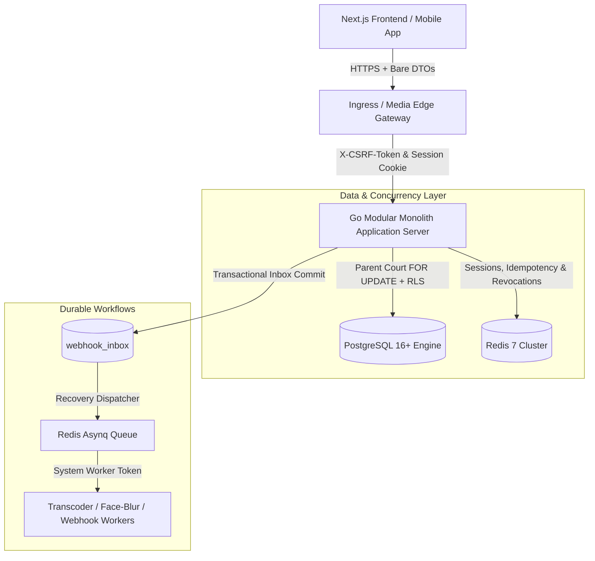

# Milestone M7: Backend Architecture Handoff & Review Guide

> **Document Type**: Authoritative Engineering Handoff & Founder Review Guide  
> **Milestone**: M7 (Backend, API, Schema, Concurrency & Security Architecture Design)  
> **Branch**: `codex/backend-architecture`  
> **Base Commit**: `6ea859b` (M6 Frontend Acceptance Merge)  
> **Primary Specification**: [BACKEND_ARCHITECTURE.md](file:///C:/Users/USER/Documents/GitHub/smartify-stadiums-frontend/BACKEND_ARCHITECTURE.md)  
> **Target Technology Stack**: Go 1.22+, PostgreSQL 16+ (PostGIS, `btree_gist`), Redis 7+, S3-Compatible Storage  
> **Verification Environment**: Validated live against isolated PostgreSQL 18.6 engine  
> **Commercial Policy Status**: All commission fees, subscription prices, and cancellation schedules remain strictly **provisional and configurable** pending formal founder approval.

---

## 1. Executive Summary: What Was Done in This Milestone

Branch `codex/backend-architecture` transitions Smartify Stadiums from the founder-approved frontend implementation (Milestone M6, commit `6ea859b`) into an enterprise-grade backend architecture. 

During Milestone M6, we verified 46 routes, 99 unit/integration tests, and 32 end-to-end browser journeys across two isolated stadium tenants, ensuring 100% truthful content, zero fake success, and strict physical court modeling. However, as documented in `AGENTS.md` and `FRONTEND_ACCEPTANCE.md`, **frontend acceptance does not establish production security, database-level concurrency guarantees, or real-money payment readiness**.

In Milestone M7, we conducted an exhaustive architectural reconciliation across all 7 core domains, establishing mathematical guarantees, durable financial state machines, and complete frontend-contract compatibility before code scaffolding begins:

---

## 2. Seven Architectural Corrections Resolved in Milestone M7

### 1. Reconciled Actual Frontend Contracts
- **Bare Response DTOs (Default)**: The frontend HTTP transport (`frontend/src/services/http.ts`) unmarshals response bodies directly via `return await response.json() as T`. The backend default contract returns bare DTOs (JSON objects for single resources, JSON arrays for collections), eliminating runtime client crashes. An optional envelope adapter (`X-API-Envelope: true`) is supported for third-party integrators.
- **CSRF Token Endpoint (`/auth/csrf`)**: Transparently called by `http.ts` prior to every state-modifying request (`POST`, `PUT`, `PATCH`, `DELETE`). The backend returns `{ "token": "..." }`, and verifies `X-CSRF-Token` against the user's session before executing mutations.
- **Exact Field Mappings**:
  - `POST /auth/request-otp`: Request body `{"phone": "...", "purpose": "login"}`.
  - `POST /auth/login`: Request body `{"phone": "...", "code": "..."}` returning bare `Account` DTO.
  - `POST /auth/register`: Request body `{"phone": "...", "code": "...", "full_name": "...", "role": "player"}` returning bare `Account` DTO.
  - `GET /users/me`: Returns bare `Account` DTO.
- **Cookie Architecture Across Subdomains**:
  - **Mode A (BFF / Same-Origin Reverse Proxy - Default)**: Uses `__Host-etsf-session; Path=/; Secure; HttpOnly; SameSite=Lax`.
  - **Mode B (Multi-Subdomain SaaS Deployment)**: For custom subdomains (`unity-complex.smartifystadiums.et`), uses RFC 6265bis-compliant `__Secure-etsf-session; Domain=.smartifystadiums.et; Path=/; Secure; HttpOnly; SameSite=Lax`.
- **Session Revocation & Instant Suspension Enforcement**:
  - Redis session store: `session:{userId}:{jti}`. On logout, session is purged.
  - On admin user suspension (`PATCH /admin/users/:id/status`), database commits `status = 'suspended'`, deletes all user Redis sessions, publishes an invalidation event over Redis Pub/Sub, and denies subsequent requests immediately with HTTP 403 `ACCOUNT_SUSPENDED` (< 50ms propagation).

### 2. Complete 26-Table Relational Data Model & Court Integrity
- **Database-Enforced Venue-Court Integrity**:
  To guarantee that **a booking's court actually belongs to its venue**, the schema enforces composite uniqueness on `fields (id, venue_id)` and binds `bookings`, `field_closures`, `cameras`, and `match_recordings` via composite foreign keys:
  `CONSTRAINT fk_bookings_field_venue FOREIGN KEY (field_id, venue_id) REFERENCES fields(id, venue_id) ON DELETE RESTRICT;`
  *(Tested and proven in PostgreSQL 18.6: cross-venue court bookings are strictly aborted by the foreign key constraint).*
- **All 15 Missing Accepted Workflows Modeled**:
  1. CMS Working Draft & Versions: `microsite_content` and `microsite_versions`.
  2. Community Teams & Rosters: `teams`, `team_members`, and `team_join_requests`.
  3. Tournaments & Events: `venue_events` and `event_registrations`.
  4. Support Threading: `support_cases` and `support_messages` (with staff internal note flags).
  5. Verifiable Consent Evidence: `privacy_consent_records`.
  6. Review Moderation History: `venue_reviews` and `venue_review_history`.
  7. Platform SaaS Invoices: `invoices`.
  8. Durable Webhook Inbox: `webhook_inbox`.
  9. Administrative Audit Log: `admin_audit_events`.

### 3. Unified Court Concurrency Protocol (Zero Double-Bookings & Closure Races)
- **Parent Asset Row Lock (`FOR UPDATE`)**:
  The exclusion constraint protects `bookings` against other `bookings`, but does not protect against concurrent inserts into `field_closures`. The architecture establishes a unified court protocol:
  `SELECT id FROM fields WHERE id = $fieldId AND venue_id = $venueId FOR UPDATE;`
  This serializes all bookings, rescheduling, and maintenance closures on that specific physical court.
- **Transaction Retry Protocol**: Automated exponential backoff with full jitter on serialization failures (`40001`) or deadlocks (`40P01`).
- **10-Minute Pending Hold Expiry**: Online reservations enforce a 10-minute hold TTL. An automated background worker expires stale holds, immediately restoring court availability.
- **Late Payment Resolution Without Double-Booking**:
  If a payment arrives after a booking was cancelled or expired:
  - If the slot is still free: re-confirms the booking and issues confirmation SMS.
  - If the slot was taken by another player: **the slot is NEVER double-booked**. Booking remains cancelled; system issues an automated gateway refund / credit balance voucher and opens an urgent support ticket.

### 4. Enforceable Multi-Tenant Authorization & Forced RLS
- **Authenticated Ownership Check**: A supplied `X-Venue-Id` header is never proof of ownership. Gateway validates caller identity from JWT and executes `SELECT 1 FROM venues WHERE id = $id AND owner_id = $userId` before setting tenant context; unauthorized requests receive HTTP 403 `VENUE_ACCESS_DENIED`.
- **Forced Row-Level Security (`FORCE ROW LEVEL SECURITY`)**: Enabled on all tenant tables. Guarantees that table owners and application roles cannot bypass RLS.
- **Restricted Database Role (`smartify_app`)**: Non-superuser role with no `BYPASSRLS` privileges.
- **Connection Pool Isolation (`SET LOCAL`)**: All tenant context is set inside explicit transaction blocks using `SELECT set_config('app.current_tenant_id', $1, true)`. Automatically rolls back on commit, preventing cross-request tenant leakage.

### 5. Append-Only Financial Ledger & Crash-Safe Idempotency
- **Append-Only Financial Ledger**: Removed unsupported "double-entry" claim; formalized as an immutable append-only ledger (`payment_transactions`) with dynamic calculation function `compute_booking_financials`.
- **Cash Walk-in Collection Status**: Manual on-site settlements (`payment_method IN ('cash', 'pos')`) are inserted directly with `status = 'succeeded'`, ensuring instant reflection in booking status and owner analytics.
- **Atomic Over-Refund Protection**:
  1. Locks parent booking `FOR UPDATE`.
  2. Calculates $\text{Available} = \sum(\text{Collections}_{\text{succeeded}}) - \sum(\text{Refunds}_{\text{succeeded}}) - \sum(\text{Refunds}_{\text{recorded}})$.
  3. Blocks over-refunds with HTTP 422 `REFUND_EXCEEDS_COLLECTED`.
  4. Reserves refund capacity with `status = 'recorded'` prior to gateway dispatch.
- **Operation-Scoped Crash-Safe Idempotency**:
  Keys are scoped to `(user_id, operation_name, key)`. States: `in_progress` -> `completed` / `failed`. Automatically recovers from worker crashes exceeding 30 seconds.

### 6. Durable Transactional Webhook Inbox & Provider-Specific Verification
- **Transactional Inbox Pattern**: Ingress handler commits raw webhook payload and headers into `webhook_inbox` with `status = 'pending'` within a database transaction BEFORE returning HTTP 200 to the provider. Eliminates lost events on worker crashes.
- **Recovery Dispatcher**: Background worker scans stalled inbox records (`created_at < NOW() - 30s`) and dispatches them to Asynq.
- **Provider-Specific Verification Protocols**:
  - **Chapa**: Validates `Chapa-Signature` HMAC-SHA256, then executes **mandatory server-to-server verification call** `GET https://api.chapa.co/v1/transaction/verify/{tx_ref}` confirming `status == 'success'`, `amount`, and `currency == 'ETB'`.
  - **Telebirr**: Validates asymmetric RSA-SHA256 signature using Ethio Telecom public certificate, decrypts AES payload, and validates `tradeStatus == 'Completed'`.
  - **CBE Birr**: Validates SHA-256 payload checksum against merchant key.

### 7. Media Revocation & Worker Authority
- **Authenticated Media Edge Gateway**: Direct S3 access is strictly disabled. All HLS traffic routes through a streaming gateway.
- **Instant Revocation (< 1s)**: Gateway verifies streaming ticket AND checks Redis `EXISTS media:revoked:{recording_id}` on **every 2-second video segment request**. Revoking consent terminates active playback mid-stream within 2–4 seconds across all viewers.
- **Worker-Only Face-Blurring Authority**: Owners cannot declare face blurring completed. Blur completion is restricted to trusted computer vision background workers via internal service token (`POST /internal/v1/workers/recordings/:id/blur-complete`) with cryptographic frame-hashing telemetry.
- **Verifiable Consent Evidence**: Consent audit log stores cryptographic evidence hashes (`evidence_type: sms_otp | guardian_consent | digital_signature`), IP addresses, user agents, and timestamps.
- **Corrected Terminology**: Fixed "asymmetric HMAC" oxymoron to symmetric HMAC-SHA256 for high-throughput edge tickets, and asymmetric Ed25519/RSA for service tokens and certificates.

---

## 3. Pre-Implementation Review Checklist for Founder & Tech Leads

| Architecture Area | Architectural Recommendation | Verification Status | Action Needed |
| :--- | :--- | :--- | :--- |
| **API Envelope & CSRF** | Bare DTOs matching `frontend/src/services/*.ts`, `/auth/csrf` token endpoint, `X-CSRF-Token` header. | Fully mapped in Section 8.1 compatibility matrix. | Ready for confirmation. |
| **Relational DDL & Integrity** | Complete 26-table DDL; composite foreign key `(field_id, venue_id)` on bookings and closures. | **Validated on PostgreSQL 18.6** (Exit code 0). | Ready for confirmation. |
| **Court Concurrency** | Parent court row locking (`FOR UPDATE`) + GiST exclusion constraint (`int4range &&`). | **Validated on PostgreSQL 18.6** (Exit code 0). | Ready for confirmation. |
| **Tenant Isolation** | Non-superuser role `smartify_app` + `FORCE ROW LEVEL SECURITY` + `SET LOCAL` connection isolation. | **Validated on PostgreSQL 18.6** (Exit code 0). | Ready for confirmation. |
| **Ledger & Refunds** | Append-only transactions; on-site cash as `succeeded`; atomic over-refund prevention with reservation state. | **Validated on PostgreSQL 18.6** (Exit code 0). | Ready for confirmation. |
| **Webhook Inbox** | Transactional inbox table + recovery dispatcher + provider-specific verification (Chapa verify API). | **Validated on PostgreSQL 18.6** (Exit code 0). | Ready for confirmation. |
| **Media Revocation** | Media Edge Gateway checking Redis revocation set on every HLS segment; worker-only blur authority. | Fully specified in Section 6. | Ready for confirmation. |
| **Commercial Terms** | Keep commission and subscription rates as **provisional configuration parameters** (`is_approved: false`). | Modeled in `commercial_policies` table. | Confirmed provisional. |

---

## 4. Next Step: Transitioning to Milestone M8

Following founder review and approval of Milestone M7:
1. **Scaffold Go Backend Repository**: Initialize `/backend` Go 1.22 module with standard library/Chi router, domain structures, and database migration framework (`golang-migrate`).
2. **Apply Migrations**: Execute the complete 26-table schema and composite constraints against development PostgreSQL.
3. **Execute Testcontainers Integration Suite**: Implement test suite covering test cases `TC-BE-01` through `TC-BE-17`.

*No backend codebase scaffolding, branch merging, git pushing, or production deployment has been performed in Milestone M7.*

4. **Connect Frontend Service Adapters**: Switch frontend transport from demo storage to live backend endpoints (`NEXT_PUBLIC_DATA_MODE=api`).
