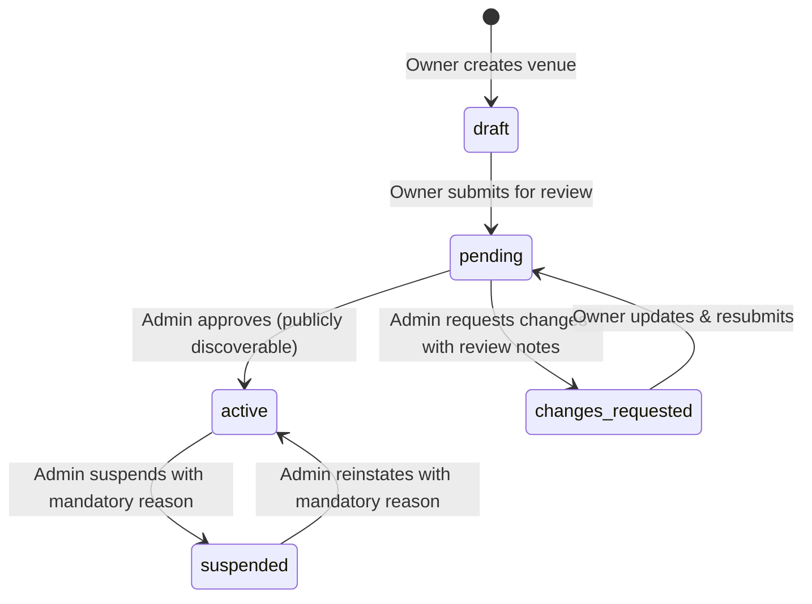
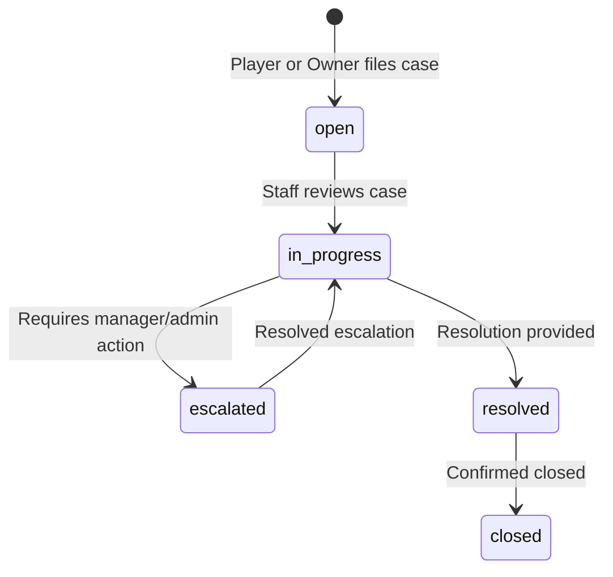

# Milestone 5: Finance & Platform Administration Handoff Document

**Date:** 2026-10-16  
**Branch:** `codex/finance-platform-admin`  
**Base Commit:** `6892311c913f9470d764bbd76506cc2041bcf16c` (Merged `main`)  
**Scope:** Departments D10 (Billing, payments, revenue and analytics) and D11 (Platform administration, support and partnerships) from [FRONTEND_MASTER_PLAN.md](file:///c:/Users/USER/Documents/GitHub/smartify-stadiums-frontend/FRONTEND_MASTER_PLAN.md).

---

## 1. Baseline Assessment

### 1.1 Existing Codebase Footprint
- **Services (`frontend/src/services`)**:
  - [`billing.service.ts`](file:///c:/Users/USER/Documents/GitHub/smartify-stadiums-frontend/frontend/src/services/billing.service.ts): Minimal stubs for `/commercial-policy`, `/owner/invoices`, `/owner/analytics`.
  - [`admin.service.ts`](file:///c:/Users/USER/Documents/GitHub/smartify-stadiums-frontend/frontend/src/services/admin.service.ts): Basic stubs for `/admin/users`, `/admin/stadiums`, `/admin/audit`, and simple `PATCH /admin/stadiums/:id` toggling `status: 'active' | 'suspended'`.
  - [`contracts.ts`](file:///c:/Users/USER/Documents/GitHub/smartify-stadiums-frontend/frontend/src/services/contracts.ts): Contains definitions for `CommercialPolicy`, `Invoice`, `AuditEntry`, `Analytics`.
- **UI Components & Pages**:
  - `OwnerBilling` in [`owner-panels.tsx`](file:///c:/Users/USER/Documents/GitHub/smartify-stadiums-frontend/frontend/src/components/owner-panels.tsx): Displays generic invoices and a notice that pricing is open.
  - `OwnerOverview` in [`owner-panels.tsx`](file:///c:/Users/USER/Documents/GitHub/smartify-stadiums-frontend/frontend/src/components/owner-panels.tsx): Shows 4 metric cards (bookings, collected, outstanding, cancelled) but currently backed by unimplemented or static data.
  - `AdminVenues` in [`admin-panels.tsx`](file:///c:/Users/USER/Documents/GitHub/smartify-stadiums-frontend/frontend/src/components/admin-panels.tsx): Simple approve/suspend toggle button with a text reason.
  - `AdminUsers` in [`admin-panels.tsx`](file:///c:/Users/USER/Documents/GitHub/smartify-stadiums-frontend/frontend/src/components/admin-panels.tsx): Name search over all accounts without status moderation or lockout protections.
  - `AdminOverview` in [`admin-panels.tsx`](file:///c:/Users/USER/Documents/GitHub/smartify-stadiums-frontend/frontend/src/components/admin-panels.tsx): Displays audit logs without detailed financial or moderation telemetry.
- **Simulator (`frontend/src/demo/transport.ts`)**:
  - `/commercial-policy` returns `{ subscriptionPriceMinor: null, bookingCommissionPercent: null, currency: 'ETB' }`.
  - `/owner/invoices` and `/owner/analytics` are currently unhandled (fallback 501 `unavailable`).
  - `state.invoices = []` and `state.audit = []` initialized in fixtures.
  - No transactional financial ledger exists; `Booking.paymentStatus` was manipulated directly without immutable settlement or transaction records.

---

## 2. Identified Gaps

1. **Coupling of Booking Status to Payment**:
   - `Booking` had a mutable `paymentStatus` field (`unpaid | processing | paid | failed | refunded`), but there was no decoupled settlement transaction record (`PaymentTransaction`).
   - Partial payments, manual cash/POS collections, overpayments, and transaction-level receipts were unsupported.
2. **Missing Transactional Invariance & History**:
   - No append-only financial records or correction/reversal mechanics.
   - Booking cancellation previously did not distinguish between slot release and payment refund.
3. **Static or Fabricated Financial Analytics**:
   - Metrics were not computed dynamically from actual underlying booking and transaction data.
   - No filtering by venue, sport, or date range; no explicit distinction between booking date and transaction/settlement date; no handling of timezone boundaries or zero-activity states.
4. **Shallow Venue Review Workflow**:
   - `AdminVenues` only had a binary toggle between `active` and `suspended`.
   - Missing states: `pending` review, `changes_requested` with review notes, resubmission, and audit history.
   - Suspension did not explicitly safeguard existing bookings and tenant records while suppressing public discovery.
5. **Lack of Support Workflows & Privacy**:
   - No support ticketing or escalation system linking players, venue owners, and platform administrators to specific bookings or transactions.
   - Staff/internal investigation notes were not segregated from customer-facing messages.
6. **Administrator Security & Self-Lockout**:
   - No safeguards preventing an administrator from suspending or demoting their own active session or the last remaining administrator on the platform.

---

## 3. Role & Permission Matrix

| Capability / Resource | Visitor | Player | Venue Owner | Platform Administrator |
|---|---|---|---|---|
| **Public Directory & Discovery** | Active venues only | Active venues only | Active venues only | All venues (draft, pending, active, suspended) |
| **Booking Creation** | Authenticated redirect | Self only | Walk-in for owned venue | View only |
| **Record Manual Settlement** | Denied | Denied | Owned venue bookings only | Denied (audit/oversight only) |
| **Execute Simulated Gateway** | Denied | Self booking | Denied | Denied |
| **Inspect Receipts & Ledger** | Denied | Self bookings only | Owned venue bookings only | Platform-wide oversight |
| **Issue / Record Refund** | Denied | Request only | Permitted on owned bookings | Review & record escalation |
| **Owner Analytics** | Denied | Denied | Owned venues only | View all venues & platform aggregate |
| **Platform Analytics** | Denied | Denied | Denied | Full access |
| **Platform Subscription Invoices** | Denied | Denied | Owned venue invoices | Full platform management |
| **Venue Review (Approve/Reject/Suspend)**| Denied | Denied | View owned status & notes | Full review, suspend, reinstate |
| **Support Cases (Player View)** | Denied | Self cases only | Denied | Full access |
| **Support Cases (Owner View)** | Denied | Denied | Owned venue cases | Full access |
| **Internal Support Notes** | Denied | Denied | Denied | Administrator staff only |
| **User Moderation (Suspend/Activate)** | Denied | Denied | Denied | Administrator (non-self, not last admin) |
| **Audit Logs** | Denied | Denied | Denied | Administrator only |

---

## 4. State Machines & Transitions

### 4.1 Settlement Transaction State Machine
- **Manual Collection**:
  - `Booking.paymentStatus`: `unpaid` -> `partially_paid` (if collected < total) -> `paid` (if collected == total).
  - Transaction record: `type: 'manual_collection'`, `status: 'recorded'`, amount in integer minor units (`ETB`).
  - Idempotency: repeated submission with identical idempotency key returns identical transaction record without secondary balance reduction.
  - Overpayment: rejected with HTTP 422 if amount > outstanding balance.
- **Simulated Gateway Payment**:
  - Transaction record: `type: 'gateway_payment'`, `status: 'initiated'` -> `processing` -> `succeeded` or `failed`.
  - Browser actions are explicitly branded and tagged as simulated test scenarios; no live banking operations.
- **Refund & Reversal**:
  - Triggered via owner settlement or admin resolution.
  - Transaction record: `type: 'refund'`, `status: 'recorded'`, referencing original transaction/booking.
  - Invariant: Booking cancellation frees the slot and marks `status: 'cancelled'`; it does **NOT** automatically issue a cash/gateway refund. Refunds are explicit financial records.

### 4.2 Venue Review State Machine

- **Suspension Invariants**:
  - Suspended venues are immediately excluded from public search (`/stadiums`), city filters, and public booking.
  - Existing bookings remain valid and accessible to players and owners for fulfillment or manual resolution.
  - Financial records, transaction history, and CMS drafts remain intact.
  - Venue approval is strictly separate from camera hardware certification (`CameraCertificationStatus`).

### 4.3 Support Case State Machine

- Case types: `booking_inquiry`, `refund_request`, `payment_dispute`, `facility_issue`, `account`.
- Messages are partitioned into `customer` (visible to ticket author and assigned parties) and `internal` (visible strictly to administrators).

---

## 5. Proposed Backend API Contracts

### 5.1 Financial & Settlement Endpoints
- `POST /owner/bookings/:id/settlement`:
  - **Body**: `{ amountMinor: number, method: 'cash' | 'pos' | 'telebirr_manual' | 'bank_transfer', notes?: string }`
  - **Headers**: `Idempotency-Key`
  - **Response**: `PaymentTransaction`
- `POST /owner/transactions/:id/refund`:
  - **Body**: `{ amountMinor: number, reason: string }`
  - **Headers**: `Idempotency-Key`
  - **Response**: `PaymentTransaction`
- `GET /owner/venues/:id/ledger`:
  - **Query**: `limit`, `offset`, `dateFrom`, `dateTo`
  - **Response**: `{ transactions: PaymentTransaction[], summary: VenueFinancialSummary }`
- `GET /owner/invoices`:
  - **Response**: `SubscriptionInvoice[]` (with referenced plan, cycle, and breakdown)
- `GET /owner/analytics`:
  - **Query**: `venueId?`, `sport?`, `dateFrom?`, `dateTo?`, `metricDateType: 'booking_date' | 'transaction_date'`
  - **Response**: `FinancialAnalytics`
- `GET /commercial-policy`:
  - **Response**: `CommercialPolicy` (explicitly unset/null when provisional)

### 5.2 Venue Administration Endpoints
- `GET /admin/stadiums`:
  - **Query**: `status?`, `search?`
  - **Response**: `VenueAdminView[]`
- `POST /admin/stadiums/:id/review`:
  - **Body**: `{ action: 'approve' | 'request_changes' | 'suspend' | 'reinstate', reason: string, notes?: string }`
  - **Response**: `Venue`
- `GET /admin/stadiums/:id/review-history`:
  - **Response**: `VenueReviewRecord[]`

### 5.3 Support & Moderation Endpoints
- `GET /support/cases`:
  - **Response**: `SupportCase[]` (scoped to actor permissions)
- `POST /support/cases`:
  - **Body**: `{ venueId?: string, bookingId?: string, transactionId?: string, category: string, subject: string, message: string }`
  - **Response**: `SupportCase`
- `GET /support/cases/:id`:
  - **Response**: `SupportCaseDetail` (internal notes stripped for non-admins)
- `POST /support/cases/:id/messages`:
  - **Body**: `{ message: string, isInternal?: boolean }`
  - **Response**: `SupportMessage`
- `PATCH /support/cases/:id`:
  - **Body**: `{ status?: SupportCaseStatus, resolution?: string }`
  - **Response**: `SupportCase`
- `PATCH /admin/users/:id`:
  - **Body**: `{ status: 'active' | 'suspended', reason: string }`
  - **Response**: `Account`
- `GET /admin/audit`:
  - **Response**: `AuditEntry[]`

---

## 6. Backend Integration Requirements

When backend engineering begins, the future server (Go + PostgreSQL) must enforce:
1. **Atomic Transactions**:
   - Recording a collection or refund must execute in an isolated database transaction with `SERIALIZABLE` or pessimistic locking (`SELECT ... FOR UPDATE`) on the booking balance.
2. **Double-Entry or Correction Invariance**:
   - Financial transactions must never be mutated or deleted in place; adjustments must occur via explicit reversal/refund records.
3. **Idempotency Guarantees**:
   - `Idempotency-Key` headers must be stored with hashed request bodies to guarantee that network retries never double-charge or double-refund.
4. **Server-Side Authorization**:
   - The browser role checks in this frontend are purely user-experience gates. The API gateway and backend handlers must independently verify tenant ownership and administrative roles before any mutation.
5. **Gateway Webhook Signatures & Reconciliation**:
   - Real payment gateway callbacks (Telebirr/Chapa) must verify cryptographic HMAC signatures and execute asynchronous reconciliation against provider settlement APIs.

---

## 7. Unresolved Business Decisions

The following commercial and operational policies remain open and provisional:
1. **Platform Booking Commission Rate**:
   - Currently illustrative 5% or unset. Commercial terms require founder approval before hardcoding.
2. **SaaS Subscription Pricing & Tier Limits**:
   - Monthly/annual subscription pricing, court/camera limits, and storage retention tiers remain provisional.
3. **Payment Gateway Provider Selection**:
   - Final choice and integration details for Ethiopian domestic gateways (Telebirr, CBE Birr, Chapa) are deferred to backend implementation.
4. **Automated Refund & Dispute Rules**:
   - Cancellation penalty windows, transaction fee deduction rules, and automated refund SLAs are subject to business policy finalization.
